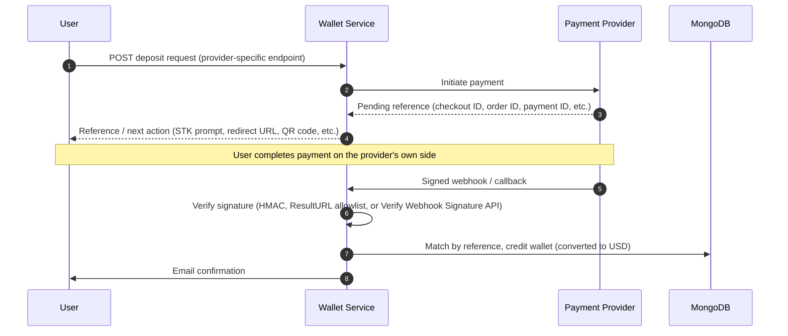
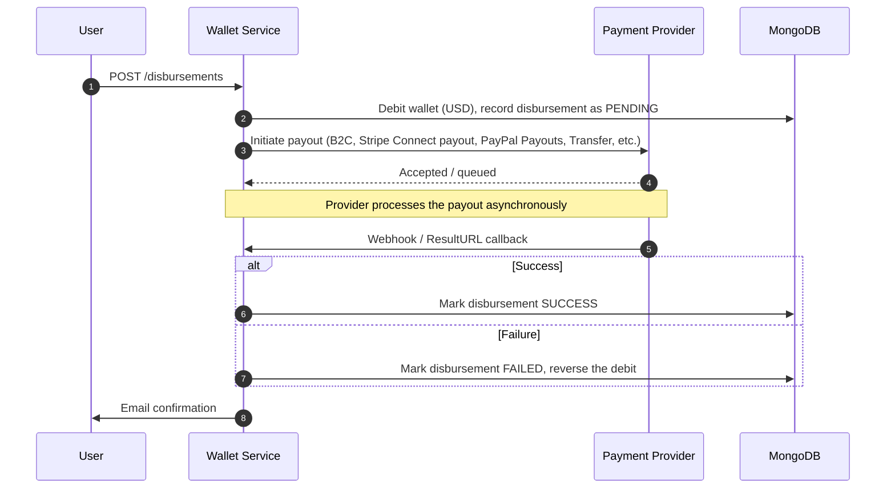
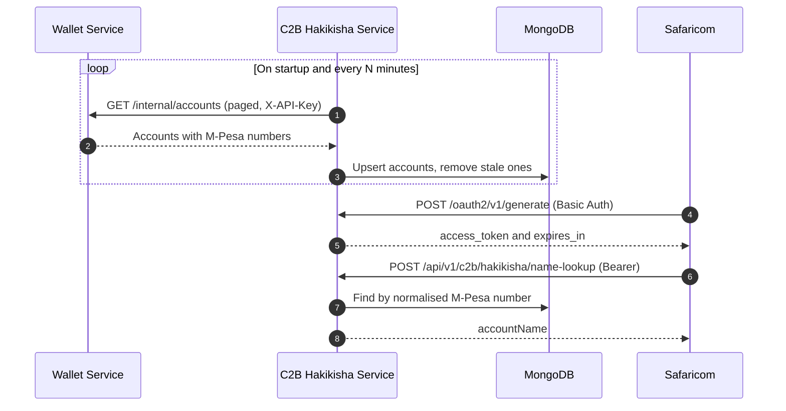

<p align="center">
  
</p>

<h1 align="center">Premisave Wallet Service: Multi-Provider Digital Wallet &amp; Payment Orchestration API</h1>

<p align="center">
  <b>A production-minded Spring Boot 4 &amp; MongoDB microservice that unifies M-Pesa, Stripe, PayPal, Flutterwave, and NOWPayments behind a single, USD-denominated wallet API for the Premisave fintech platform, and offers the same rails to outside businesses through a commercial payment service provider API.</b>
</p>

<p align="center">
  <a href="https://github.com/peacemakerbill">
    
  </a>
  <br/>
  <sub>Built by <a href="https://github.com/peacemakerbill"><b>Bill Graham Peacemaker</b></a> (<code>@peacemakerbill</code>) · Backend Developer &amp; API Support Engineer · Nairobi, Kenya</sub>
</p>

<p align="center">
  
  
  
  
  
  
</p>

<p align="center">
  
  
  
  
  
</p>

<p align="center">
  <a href="https://github.com/peacemakerbill/premisave-wallet-service/stargazers"></a>
  <a href="https://github.com/peacemakerbill/premisave-wallet-service/network/members"></a>
  <a href="https://github.com/peacemakerbill/premisave-wallet-service/issues"></a>
  <a href="https://github.com/peacemakerbill/premisave-wallet-service/commits"></a>
  
  
  
</p>

<p align="center">
  <a href="#quick-start">Quick start</a> ·
  <a href="#architecture">Architecture</a> ·
  <a href="#how-deposits-work-all-providers">How deposits work</a> ·
  <a href="#how-disbursements-work-all-providers">How disbursements work</a> ·
  <a href="#api-reference">API reference</a> ·
  <a href="#commercial-api-payment-service-provider">Commercial API</a> ·
  <a href="#configuration-reference">Configuration</a> ·
  <a href="#troubleshooting">Troubleshooting</a>
</p>

> **If this saves you time integrating multi-provider payments in Java, please star the repo.** It helps other Kenyan fintech developers find it.

> **Disclaimer.** This is an independent, community-built project shared as a portfolio and reference implementation. It is not an official product of, and is not affiliated with or endorsed by, Safaricom, Stripe, PayPal, Flutterwave, or NOWPayments. M-PESA is a trademark of Safaricom PLC. Always follow each provider's own current documentation for onboarding and go-live requirements.

---

## Table of contents

1. [What is this?](#what-is-this)
2. [Features](#features)
3. [Supported payment providers](#supported-payment-providers)
4. [Architecture](#architecture)
5. [How deposits work (all providers)](#how-deposits-work-all-providers)
6. [How disbursements work (all providers)](#how-disbursements-work-all-providers)
7. [Currency and ledger model](#currency-and-ledger-model)
8. [Quick start](#quick-start)
9. [Build and run](#build-and-run)
10. [Configuration reference](#configuration-reference)
11. [API reference](#api-reference)
12. [Testing with Postman or curl](#testing-with-postman-or-curl)
13. [Admin and financial reporting](#admin-and-financial-reporting)
14. [Data model](#data-model)
15. [Commercial API (payment service provider)](#commercial-api-payment-service-provider)
    - [Where it fits](#where-it-fits) · [Setup notes](#setup-notes-for-the-commercial-api) · [Contract](#contract) · [How money moves](#how-money-moves) · [Payment rails](#payment-rails)
    - [Settlements, transfers and reports](#settlements-transfers-and-reports) · [Links, references, bulk payouts, beneficiary checks](#payment-links-account-references-bulk-payouts-and-beneficiary-checks) · [Refunds and disputes](#refunds-and-disputes) · [Subscriptions](#subscriptions)
    - [Paybill references and validation](#paybill-account-references-and-validation-callbacks) · [Merchant numbers and onboarding](#merchant-numbers-and-onboarding) · [Document folder setup](#document-folder-setup) · [Developer service split](#developer-service-split) · [Commercial operations](#commercial-operations)
16. [Going live](#going-live)
17. [Security notes](#security-notes)
18. [Project structure](#project-structure)
19. [Troubleshooting](#troubleshooting)
20. [Upgrading from earlier deliveries](#upgrading-from-earlier-deliveries)
21. [Known limits](#known-limits)
22. [Roadmap ideas](#roadmap-ideas)
23. [Contributing](#contributing)
24. [Author](#author)

---

## What is this?

**Premisave Wallet Service** is the financial backbone of the Premisave platform: a Java Spring Boot microservice that gives every user one wallet, held in one currency (USD), regardless of which of five independent payment rails actually moved the money.

Each payment gateway has its own currency conventions, its own callback shape, its own idea of what "success" means, and its own asynchronous timing. Rather than letting that complexity leak into every other Premisave microservice, this project absorbs it entirely. It:

- exposes one consistent wallet API for deposits, disbursements, transfers, and payments, regardless of which provider is behind a given request,
- converts every provider's native settlement currency to USD at the moment money enters or leaves the wallet, using a live, cached exchange rate,
- reconciles every provider's asynchronous webhook or callback against the original transaction by an idempotency reference, so a retried delivery can never double-credit or double-debit a wallet,
- gives platform admins one place to see how much money moved, how much the platform earned, and which operations still need manual follow-up.

On top of that wallet sits a commercial API: the same rails, ledger and webhook handling, offered to outside businesses (merchants) through the separate developer service, with merchant onboarding, settlements, bulk payouts, refunds, disputes and subscription billing. It is described in [Commercial API](#commercial-api-payment-service-provider).

It was built for the Premisave platform's own microservice ecosystem (alongside `auth-service` and `property-service`), but the provider-integration boundary is isolated per service class, so adding a sixth payment rail does not require touching the wallet-crediting logic itself.

## Features

| | |
|---|---|
| **Unified USD wallet** | Every balance is held in USD as ground truth, regardless of which currency a provider actually settles in. |
| **Five payment providers, one API** | M-Pesa (STK Push, C2B, B2C, B2B, B2Pochi, Reversal, Account Balance, Transaction Status, Pull Transactions), Stripe (PaymentIntents, saved cards, Stripe Connect), PayPal (Orders, vaulting, Payouts), Flutterwave v4, NOWPayments crypto. |
| **Live currency conversion** | Scheduled background refresh from the Frankfurter API, cached in Redis and MongoDB, covering 160+ currency pairs. |
| **Wallet-to-wallet transfers** | Instant internal transfers between Premisave users, fully commission-tracked. |
| **Direct payment processing** | Subscription- and booking-fee-style payments where the full amount is recorded as company revenue, not a percentage cut. |
| **Webhook-driven reconciliation** | Signature-verified callback handling for every provider, with idempotent processing and raw-payload audit logging. |
| **Admin financial reporting** | Daily reports, all-time system summary, balance overview, and gateway reconciliation, all normalized to USD. |
| **Automated email notifications** | Deposit, disbursement, transfer, and payment confirmations with resolved sender and recipient names. |
| **Dual authentication model** | JWT for end users, a shared internal API key for service-to-service calls from the rest of the Premisave ecosystem. |
| **Rate limiting** | Token-bucket request throttling via Bucket4j. |
| **Commercial payment service provider API** | Merchants collect payments, pay out singly or in bulk, check beneficiary names, settle, refund, handle disputes and bill subscribers over the same rails, with a sandbox and a live environment. |
| **Merchant onboarding** | Application form, document upload to a local or network (NAS) folder, review by finance, operations and admin staff, return for correction, approval, emails and a timeline. |
| **Subscription billing** | Plans, customers, saved payment methods, invoices, retries and dunning. |
| **OpenAPI 3 documentation** | Full API spec generation via springdoc-openapi. |

## Supported payment providers

| Provider | Deposits | Disbursements | Notes |
|---|:---:|:---:|---|
| **M-Pesa (Safaricom Daraja)** | Yes | Yes | STK Push, C2B, B2C, B2B, B2Pochi, Reversal, Account Balance, Transaction Status, Pull Transactions |
| **Stripe** | Yes | Yes | PaymentIntents, saved cards, Stripe Connect for cross-border payouts |
| **PayPal** | Yes | Yes | Orders API, vaulted payment methods, Payouts API |
| **Flutterwave (v4)** | Yes | Yes | Charges and Transfers |
| **NOWPayments** | Yes | Yes | Cryptocurrency deposits and payouts |

The commercial API reuses these same provider accounts and credentials; each commercial rail is switched on separately and is off by default (see [Payment rails](#payment-rails)).

## Architecture

```
┌──────────────┐      JWT       ┌────────────────────────┐
│   End User   │ ─────────────► │                        │
└──────────────┘                │                        │      ┌─────────────┐
                                 │   Premisave Wallet     │ ───► │  M-Pesa     │
┌──────────────┐  X-API-Key     │      Service            │ ───► │  Stripe     │
│ auth-service │ ◄────────────► │  (this repository)     │ ───► │  PayPal     │
├──────────────┤                │                        │ ───► │ Flutterwave │
│property-serv.│ ◄────────────► │  MongoDB <-> Redis     │ ───► │ NOWPayments │
├──────────────┤                │                        │      └─────────────┘
│c2b-hakikisha │ ─── reads ───► │  /internal/accounts    │
└──────────────┘                └────────────────────────┘
```

**Design choices**

- **One wallet-crediting/debiting path, five thin provider integrations.** Every provider's own service class is responsible only for translating that provider's own initiation call and webhook payload into the same shared, currency-converted deposit/disbursement pipeline.
- **The webhook is the source of truth, never the initiation response.** A provider's initiation call only ever returns a pending reference — the wallet is only credited or the disbursement only finalized once a signed webhook confirms the outcome.
- **Merchants never call this service.** The commercial API is reached only through the developer service (port 8091), which authenticates API keys and forwards to `/internal/commercial/v1/**` with the internal key. See [Developer service split](#developer-service-split).
- **Sibling services never call payment providers directly.** `auth-service` and `property-service` reach payment functionality only through this service's `/internal/**` API, keyed by a shared internal API key.

## How deposits work (all providers)



This single shape covers M-Pesa STK Push, Stripe PaymentIntents, PayPal Orders, Flutterwave Charges, and NOWPayments crypto deposits. Only the provider-specific initiation call and callback payload shape differ; the reconciliation pattern itself does not.

| Provider | Initiation | Webhook signal | Signature verification |
|---|---|---|---|
| M-Pesa | STK Push (`/mpesa/stkpush`) or Pull Transactions | Safaricom ResultURL callback | IP allowlist at gateway/firewall level |
| Stripe | PaymentIntent creation | `payment_intent.succeeded` webhook event | Stripe webhook signing secret |
| PayPal | Order creation | `CHECKOUT.ORDER.APPROVED` / `PAYMENT.CAPTURE.COMPLETED` webhook | PayPal Verify Webhook Signature API |
| Flutterwave | Charge creation | `charge.completed` webhook | HMAC-SHA256 over the raw body |
| NOWPayments | Payment creation | IPN callback with `payment_id` | HMAC-SHA512 over the sorted JSON body |

## How disbursements work (all providers)



This same shape covers M-Pesa B2C/B2Pochi/B2B, Stripe Connect payouts, PayPal Payouts, Flutterwave Transfers, and NOWPayments payouts. The wallet is debited optimistically at initiation and only ever refunded if the provider later reports failure, never left in an ambiguous state.

### Example integration: C2B Hakikisha name lookup

A concrete example of the `/internal/**` API in action, beyond deposits and disbursements: the sibling **C2B Hakikisha** service (Safaricom's M-Pesa name-lookup API) polls this service's `GET /internal/accounts` endpoint to keep its own copy of M-Pesa and Pochi phone numbers in sync, then answers Safaricom's name-lookup requests entirely from its own local database. This service is never called synchronously in that hot path.



## Currency and ledger model

- **USD is the only currency a `Wallet` document ever stores.** Conversion happens once, at the point money enters or leaves the system, using the exchange rate in effect at that moment. Admin reporting never has to reconcile mixed-currency totals.
- **Exchange rates** are sourced from the [Frankfurter API](https://www.frankfurter.app/) (ECB reference rates), refreshed on a schedule, and cached in Redis (fast path) and MongoDB (durable fallback and historical record) — 160+ pairs tracked.
- **Every revenue-generating operation** — gateway disbursement commissions, internal transfer commissions, and direct payment revenue — is recorded as a `CompanyLedgerEntry`, always normalized to USD, powering the admin financial reports.
- **Idempotency**: every deposit, disbursement, transfer, and payment carries a `reference`, either caller-supplied or an auto-generated UUID, checked before any money movement happens.

## Quick start

### Prerequisites

- **Java 21**
- **Maven 3.9+**
- **MongoDB** running locally, in Docker, or on Atlas
- **Redis** running locally or hosted
- Sandbox/developer credentials for whichever payment providers you intend to test (M-Pesa Daraja, Stripe, PayPal, Flutterwave, NOWPayments)

```bash
# 1. Clone
git clone https://github.com/peacemakerbill/premisave-wallet-service.git
cd premisave-wallet-service

# 2. Start MongoDB and Redis (skip if you already have them)
docker run -d --name wallet-mongo -p 27017:27017 mongo:8
docker run -d --name wallet-redis -p 6379:6379 redis:7

# 3. Create your .env (see the next section), then run
mvn spring-boot:run
```

Create a `.env` file next to `pom.xml`:

```properties
# Core
MONGODB_URI=mongodb://localhost:27017/premisave-wallet
REDIS_HOST=localhost
REDIS_PORT=6379
JWT_SECRET=<a long, random secret shared with auth-service>
INTERNAL_API_KEY=<a shared secret, identical across every Premisave microservice>

# Auth Service Integration
AUTH_SERVICE_URL=http://localhost:8080

# M-Pesa Daraja
MPESA_CONSUMER_KEY=...
MPESA_CONSUMER_SECRET=...
MPESA_SHORTCODE=...
MPESA_PASSKEY=...
MPESA_CALLBACK_URL=...

# Stripe / PayPal / Flutterwave / NOWPayments
STRIPE_SECRET_KEY=...
PAYPAL_CLIENT_ID=...
FLUTTERWAVE_CLIENT_ID=...
NOWPAYMENTS_API_KEY=...

# Commercial API (optional, see the Commercial API section)
COMMERCIAL_ONBOARDING_STORAGE_PATH=/mnt/synology/premisave-onboarding
DEVELOPER_SERVICE_URL=
DEVELOPER_SERVICE_API_KEY=
```

> **Important:** write `.env` values without quotes and without trailing spaces. Provider callback URLs (`MPESA_CALLBACK_URL` and similar) must be real, publicly reachable HTTPS URLs even in sandbox testing — a tunnel such as ngrok or Cloudflare Tunnel works for local development.

When the service is healthy you will see lines like:

```
Tomcat started on port 8084 (http) with context path '/'
M-Pesa access token generated successfully: expiresInSeconds=3599
Exchange rate refresh complete: 166 refreshed, 0 failed
```

## Build and run

```bash
# Compile and package an executable jar
mvn clean package

# Run it (environment variables or a .env in the working directory)
java -jar target/premisave-wallet-service-0.0.1-SNAPSHOT.jar
```

**Notes**

- `.env` is loaded from the working directory. Real environment variables (Docker, Kubernetes, systemd) also work and take precedence over `.env`.
- The service starts on **port 8084** by default (`server.port` in `application.yml`).

## Configuration reference

Every setting lives in `src/main/resources/application.yml` and can be overridden by an environment variable or `.env`.

| Environment variable | Default | Required | Description |
|---|---|---|---|
| `MONGODB_URI` | `mongodb://localhost:27017/premisave-wallet` | no | MongoDB connection string. |
| `REDIS_HOST` / `REDIS_PORT` | `localhost` / `6379` | no | Redis connection for exchange-rate caching and rate limiting. |
| `JWT_SECRET` | dev default | **yes in production** | Must match every other Premisave service validating the same tokens. |
| `INTERNAL_API_KEY` | none | **yes** | Shared secret every Premisave microservice presents as `X-API-Key` when calling this service's `/internal/**` endpoints, and this service presents when calling out to `auth-service`. |
| `AUTH_SERVICE_URL` | `http://localhost:8080` | no | Base URL of the auth-service used for user detail lookups. |
| `RATE_LIMIT_REQUESTS_PER_MINUTE` | `60` | no | Token-bucket capacity per client. |
| `MPESA_CONSUMER_KEY` / `MPESA_CONSUMER_SECRET` | none | **yes** | Daraja app credentials. |
| `MPESA_SHORTCODE` / `MPESA_PASSKEY` | none | **yes** | STK Push shortcode and passkey. |
| `MPESA_CALLBACK_URL` | none | **yes** | Public HTTPS URL for the STK Push callback. |
| `MPESA_B2C_*` / `MPESA_B2B_*` / `MPESA_POCHI_*` | none | **yes, per channel used** | Initiator name/password, shortcode, and result/timeout URLs per disbursement channel. |
| `STRIPE_SECRET_KEY` | none | **yes** | Stripe API secret key. |
| `STRIPE_WEBHOOK_SECRET` | none | **yes** | Platform webhook signing secret. |
| `STRIPE_CONNECT_WEBHOOK_SECRET` | none | yes, if using Stripe Connect payouts | Separate webhook destination for connected-account payout events. |
| `PAYPAL_CLIENT_ID` / `PAYPAL_CLIENT_SECRET` | none | **yes** | PayPal REST app credentials. |
| `PAYPAL_WEBHOOK_ID` | none | **yes** | Required for PayPal's Verify Webhook Signature API. |
| `FLUTTERWAVE_CLIENT_ID` / `FLUTTERWAVE_CLIENT_SECRET` | none | **yes** | Flutterwave v4 app credentials. |
| `FLUTTERWAVE_WEBHOOK_SECRET_HASH` | none | **yes** | Key used to HMAC-verify the `flutterwave-signature` header. |
| `NOWPAYMENTS_API_KEY` | none | **yes** | NOWPayments API key. |
| `NOWPAYMENTS_IPN_SECRET` | none | **yes** | IPN callback signature secret. |
| `COMMISSION_INTERNAL_TRANSFER_RATE` | `0.01` | no | Commission rate on wallet-to-wallet transfers. |
| `COMMISSION_GATEWAY_RATE` | `0.03` | no | Commission rate on gateway-bound disbursements. |
| `EXCHANGE_RATE_REFRESH_INTERVAL_MS` | `1200000` (20 min) | no | How often previously-used currency pairs are refreshed. |
| `B2B_NOTIFICATION_RECIPIENTS` | none | no | Comma-separated admin/finance emails notified on every M-Pesa B2B outcome. |
| `FRONTEND_URL` | `http://localhost:3000` | no | Allowed CORS origin. |

The service **refuses to start** if `INTERNAL_API_KEY` is missing, by design.

### Commercial API settings

`application.yml` reads everything from environment variables, and `.env.example` lists them with comments. `additional-spring-configuration-metadata.json` documents the keys for the IDE. Every commercial key has a default, so adding them is optional.

#### Environment variables by group

| Group | Variables |
|:-|:-|
| Database and cache | `MONGODB_URI`, `REDIS_HOST`, `REDIS_PORT` |
| Auth | `AUTH_SERVICE_URL`, `JWT_SECRET` |
| Internal calls | `INTERNAL_API_KEY` |
| Mail | `MAIL_HOST`, `MAIL_PORT`, `MAIL_USERNAME`, `MAIL_PASSWORD` (Gmail needs an app password) |
| Frontend | `FRONTEND_URL` |
| M-Pesa Daraja | `MPESA_CONSUMER_KEY`, `MPESA_CONSUMER_SECRET`, `MPESA_SHORTCODE`, `MPESA_PASSKEY`, `MPESA_CALLBACK_URL`, `MPESA_ENV`, `MPESA_CERT_PATH`, and the B2C, B2B, status, pull, balance, reversal and Pochi groups, each with initiator name, password, security credential, shortcode and timeout and result URLs |
| Cloudinary (receipts) | `CLOUDINARY_CLOUD_NAME`, `CLOUDINARY_API_KEY`, `CLOUDINARY_API_SECRET` |
| Stripe | `STRIPE_SECRET_KEY`, `STRIPE_WEBHOOK_SECRET`, `STRIPE_CONNECT_*` |
| PayPal | `PAYPAL_CLIENT_ID`, `PAYPAL_CLIENT_SECRET`, `PAYPAL_ENV`, `PAYPAL_WEBHOOK_ID`, `PAYPAL_RETURN_URL`, `PAYPAL_CANCEL_URL` |
| Flutterwave v4 | `FLUTTERWAVE_CLIENT_ID`, `FLUTTERWAVE_CLIENT_SECRET`, `FLUTTERWAVE_ENCRYPTION_KEY`, `FLUTTERWAVE_ENV`, `FLUTTERWAVE_WEBHOOK_SECRET_HASH`, `FLUTTERWAVE_REDIRECT_URL` |
| NOWPayments | `NOWPAYMENTS_BASE_URL`, `NOWPAYMENTS_API_KEY`, `NOWPAYMENTS_IPN_SECRET`, `NOWPAYMENTS_CALLBACK_URL`, `NOWPAYMENTS_PAYOUT_EMAIL`, `NOWPAYMENTS_PAYOUT_PASSWORD` |
| Commission and rates | `COMMISSION_INTERNAL_TRANSFER_RATE`, `COMMISSION_GATEWAY_RATE`, `EXCHANGE_RATE_REFRESH_INTERVAL_MS`, `EXCHANGE_RATE_BASE_CURRENCY`, `EXCHANGE_RATE_MAX_RETRIES` |
| Commercial general | `COMMERCIAL_ENABLED`, `COMMERCIAL_SERVES` (`live`, `sandbox` or `both`), `COMMERCIAL_CURRENCIES`, `COMMERCIAL_SANDBOX_REDIRECT_BASE`, `COMMERCIAL_SIGNING_ENABLED`, `COMMERCIAL_SIGNING_SECRETS` |
| Events to the developer service | `DEVELOPER_SERVICE_URL`, `DEVELOPER_SERVICE_API_KEY`, `COMMERCIAL_EVENTS_DISPATCHER_ENABLED`, `COMMERCIAL_EVENTS_SIGNING_SECRET` |
| Onboarding | `COMMERCIAL_ONBOARDING_ENABLED`, `COMMERCIAL_ONBOARDING_STAFF_EMAILS`, `COMMERCIAL_ONBOARDING_MAIL_FROM`, `COMMERCIAL_ONBOARDING_STORAGE_PATH` |
| Payment links | `COMMERCIAL_LINKS_CHECKOUT_BASE_URL`, `COMMERCIAL_LINKS_SANDBOX_CHECKOUT_BASE_URL` |
| Commercial rails | `COMMERCIAL_MPESA_ENABLED`, `COMMERCIAL_MPESA_CALLBACK_BASE_URL`, `COMMERCIAL_MPESA_CALLBACK_SECRET`, `COMMERCIAL_STRIPE_ENABLED`, `COMMERCIAL_STRIPE_PUBLISHABLE_KEY`, `COMMERCIAL_STRIPE_WEBHOOK_SECRET`, `COMMERCIAL_PAYPAL_ENABLED`, `COMMERCIAL_FLUTTERWAVE_ENABLED`, `COMMERCIAL_NOWPAYMENTS_ENABLED`, `COMMERCIAL_PREMISAVE_ENABLED` |

#### Commercial settings by feature

```
commercial.enabled, serves, currencies    currencies must include every currency a rail serves, for example USD,KES,GHS,UGX
commercial.quote-ttl-seconds              how long a priced quote stays valid (900)
commercial.signing.enabled, secrets, replay-window-seconds    HMAC request signing from the developer service ([Security notes](#security-notes))
commercial.sandbox.auto-resolve-delay-ms, redirect-base       sandbox behaviour (3000 ms; COMMERCIAL_SANDBOX_REDIRECT_BASE)
commercial.indexes.ensure                 create declared indexes at startup (default true)
commercial.events.developer-service-url, api-key, dispatcher-enabled, signing-secret
commercial.mpesa.enabled, callback-base-url (https), callback-secret (16+ characters),
                collection-max-kes, poll-after-seconds, poll-interval-ms, http-timeout-seconds
commercial.rails.stripe.enabled, webhook-secret              (reuses stripe.* credentials)
commercial.rails.paypal.enabled                              (reuses paypal.* credentials)
commercial.rails.flutterwave.enabled                         (reuses flutterwave.* credentials)
commercial.rails.nowpayments.enabled                         (reuses nowpayments.* credentials)
commercial.rails.premisave.enabled, consent-minutes, mandate-max-usd-cents
commercial.rails.polling.after-seconds, setup-timeout-hours
commercial.c2b.enabled, shortcode, response-type (Cancelled or Completed), merchant-validation,
                validation-deadline-ms, register-on-startup, reprocess-after-seconds, sweep-interval-ms
commercial.links.checkout-base-url, sandbox-checkout-base-url
commercial.batches.items-per-run, dispatch-interval-ms, dispatcher-enabled, stuck-after-minutes, max-items
commercial.beneficiary.cache-hours
commercial.settlements.scheduler-enabled, scheduler-interval-ms
commercial.transfers.recovery-interval-ms
commercial.refunds.approval-threshold-usd, recovery-interval-ms
commercial.disputes.evidence-window-days, recovery-interval-ms
commercial.billing.scheduler-enabled, scheduler-interval-ms, upcoming-days, stuck-minutes, batch-size, clock-wait-ms
commercial.onboarding.enabled, required-documents, max-document-bytes, max-documents,
                staff-notify-emails, mail-from, roles.*, storage.path
```

The service refuses to start if the M-Pesa rail or the C2B paybill settings are enabled but invalid: a callback address that is not https, a secret under 16 characters, or a shortcode that is not 5 to 7 digits. The other rails do not check their settings at startup; a missing provider key shows up as a failed call.

## API reference

Base URL (local): `http://localhost:8084`

The service exposes REST endpoints under four broad namespaces:

| Namespace | Auth | Purpose |
|---|---|---|
| `/wallet/**` | JWT | Wallet operations, transfers, linked payment methods |
| `/payments/**` | JWT + public webhooks | Payment initiation and provider webhook callbacks |
| `/disbursements/**` | JWT | Withdrawal/payout initiation |
| `/admin/**` | JWT (Admin/Finance/Operations roles) | Financial reporting, reconciliation, manual adjustments |
| `/internal/**` | Internal API Key | Service-to-service calls from other Premisave microservices |
| `/internal/commercial/v1/**` | Internal API Key (and optional request signing) | The commercial API, called only by the developer service. See [Commercial API](#commercial-api-payment-service-provider) |

### `POST /payments/deduct`: deduct from the caller's own wallet

| | |
|---|---|
| **Header** | `Authorization: Bearer <JWT>` |

Request:

```json
{
  "amount": 5.00,
  "service": "AD_SUBSCRIPTION",
  "reference": "ad-sub-1758..."
}
```

Response (`200`):

```json
{
  "success": true,
  "message": "Payment processed",
  "data": {
    "success": true,
    "transactionId": "68f2a1b9c3d4e5f6a7b8c9d0",
    "message": "Payment successful"
  },
  "timestamp": "2026-09-19T14:22:01.123456"
}
```

### `POST /internal/payment`: deduct from a specified user's wallet

| | |
|---|---|
| **Header** | `X-API-Key: <INTERNAL_API_KEY>` |

Request:

```json
{
  "userId": "6a1621d0bf15ee8cbe8f24b5",
  "amount": 5.00,
  "service": "AD_SUBSCRIPTION",
  "description": "August 2026 ad subscription",
  "initiatedBy": "PROPERTY_SERVICE",
  "reference": "ad-sub-1758..."
}
```

Response shape is identical to `/payments/deduct` above — both endpoints share the same underlying processing method.

### `POST /wallet/transfer`: wallet-to-wallet transfer

| | |
|---|---|
| **Header** | `Authorization: Bearer <JWT>` |

Request:

```json
{
  "amount": 100.00,
  "recipientAccountNumber": "recipient@example.com",
  "description": "Rent split"
}
```

### `POST /internal/transfer`: wallet-to-wallet transfer for another service

| | |
|---|---|
| **Header** | `X-API-Key: <INTERNAL_API_KEY>` |

Request:

```json
{
  "senderUserId": "69fb94e91b08bb5028283c2b",
  "recipientAccountNumber": "recipient@example.com",
  "amount": 50.00,
  "description": "Maintenance fee split",
  "initiatedBy": "PROPERTY_SERVICE"
}
```

Response shape is identical to `/wallet/transfer`.

**`transactionId` is not the same kind of value across the two pairs.** For `/payments/deduct` and `/internal/payment` it is the `Payment` document's own MongoDB id, which can be looked up in the `Payment` collection. For `/wallet/transfer` and `/internal/transfer` it is the `reference` that was sent (or the generated UUID), which is an idempotency key rather than a database id. A caller that stores this value has to know which convention applies to the endpoint it called. Optional fields: `description` (also accepted as `reason` or `purpose` on transfers) and `reference`, the idempotency key, which is recommended.

### `GET /internal/accounts`: wallet-owner directory

| | |
|---|---|
| **Header** | `X-API-Key: <INTERNAL_API_KEY>` |
| **Query** | `page` (default `0`), `size` (default `20`) |

Returns, per account: `userId`, `accountNumber`, `fullName`, `frozen`, `mpesaPhoneNumber`, `pochiPhoneNumber`, `paypalEmail`, `paypalConnectedEmail`, `stripeConnected`, `stripePayoutsEnabled`, `flutterwavePaymentMethodNetwork`, `flutterwavePaymentMethodPhone`, `createdAt`. Consumed by the sibling C2B Hakikisha service to keep its own M-Pesa/Pochi lookup table in sync.

## Testing with Postman or curl

```bash
BASE=http://localhost:8084
TOKEN="<a real JWT for a test user>"

# Deduct a payment from the caller's own wallet
curl -s -X POST "$BASE/payments/deduct" \
  -H "Authorization: Bearer $TOKEN" \
  -H "Content-Type: application/json" \
  -d '{"amount":5.00,"service":"AD_SUBSCRIPTION","reference":"ad-sub-test-1"}'

# Internal, service-to-service payment (no JWT)
curl -s -X POST "$BASE/internal/payment" \
  -H "X-API-Key: $INTERNAL_API_KEY" \
  -H "Content-Type: application/json" \
  -d '{"userId":"<user id>","amount":5.00,"service":"AD_SUBSCRIPTION","initiatedBy":"PROPERTY_SERVICE","reference":"ad-sub-test-2"}'

# List saved accounts (consumed by C2B Hakikisha)
curl -s -H "X-API-Key: $INTERNAL_API_KEY" "$BASE/internal/accounts?page=0&size=20"
```

The commercial API has its own Postman collection (about 140 requests) and live and sandbox environments in `postman/`.

**Collection variables worth saving in Postman:** `base_url_wallet`, `internal_api_key`, `jwt_token`, `test_user_id`, `test_recipient_email`.

## Admin and financial reporting

Beyond the core wallet API, the service exposes a dedicated admin surface (role-gated: `ADMIN`, `FINANCE`, `OPERATIONS`):

| Capability | What it answers |
|---|---|
| **Daily finance report** | Deposits, disbursements, transfers, and payment volume for a given day, plus that day's commission and direct-revenue breakdown, all in USD. |
| **System summary** | All-time platform totals: cumulative volume per transaction type, total commission revenue, total direct payment revenue since launch. |
| **Balance overview** | Total wallet liability across every user, plus which wallets have which payment methods linked. |
| **Gateway reconciliation** | A paginated, filterable audit trail of every M-Pesa API operation, including which never received a ResultURL callback and need manual follow-up. |
| **Manual wallet adjustments** | Admin-initiated balance corrections, fully audit-logged as their own ledger entry type, never a silent database edit. |

Every figure is normalized to USD, even where the underlying stored records span multiple provider currencies or predate a currency-handling fix.

## Data model

The `Wallet` document (one per user) carries the fields most integration partners need:

| Field | Purpose |
|---|---|
| `userId` / `accountNumber` | The owning user's ID and email. |
| `balance` / `currency` | Always USD. |
| `frozen` | A frozen wallet cannot send or receive money. |
| `mpesaPhoneNumber` / `pochiPhoneNumber` | Linked M-Pesa numbers, kept as two genuinely distinct fields. |
| `paypalEmail` / `paypalConnectedEmail` | Manually-entered payout email versus PayPal-vault-confirmed email — deliberately distinct. |
| `stripeConnectedAccountId` / `stripePayoutsEnabled` | Stripe Connect linkage and payout eligibility. |
| `flutterwavePaymentMethodNetwork` / `flutterwavePaymentMethodPhone` | Saved Flutterwave mobile-money payment method. |

The commercial API adds its own collections (merchants, commercial transactions, merchant wallets and ledger, holds, links, batches, billing, disputes, onboarding and more). They are listed under [Commercial operations](#commercial-operations).

## Commercial API (payment service provider)

The same five rails, plus the Premisave wallet itself, are also offered to outside businesses (merchants) through a commercial API. Merchants accept payments by mobile money, card, PayPal, bank transfer, crypto and Premisave wallets, pay out singly or in bulk, check beneficiary names, bill subscribers, refund, handle disputes, settle to their own destinations and read reports. All of it lives in the `com.premisave.wallet.commercial` package; the core wallet code described above is not rewritten by it. This part of the README replaces the earlier phase, stage, install and split notes. The request and response reference is kept in [`docs/COMMERCIAL_API_ENDPOINTS.md`](docs/COMMERCIAL_API_ENDPOINTS.md), with the Postman collections in `postman/`.

### Where it fits

| Service | Role | Port |
|:-|:-|:-|
| `premisave-wallet-service` (this one) | Wallets, ledger, providers, merchants, onboarding, commercial API | 8084 |
| `premisave-developer-service` | Developer accounts, apps, API keys, the public `/v1` entry that merchants call, email confirmation, social sign in | 8091 |
| Auth service | Issues the JWTs users present to the wallet | 8080 |
| Property service and other Premisave services | Call `/internal/payment` and `/internal/transfer` | n/a |

The commercial API is called only by the developer service, never by merchants directly. All its routes sit under `/internal/commercial/v1` and must not be reachable from the internet. Section 16 describes the split.

### Setup notes for the commercial API

1. `INTERNAL_API_KEY` must be the same string in this service, the developer service and the property service. The developer service sends it on every call to `/internal/commercial/**`. `DEVELOPER_SERVICE_API_KEY` must equal the developer service's `DEVELOPER_INTERNAL_API_KEY`. Generate shared secrets with `openssl rand -base64 32`.
2. Set the document folder (see [Document folder setup](#document-folder-setup)) and the mail settings if you use merchant onboarding.
3. `SecurityConfig` needs the public callback list and `WebConfig` needs the rate limiter exclusion list to contain the line `"/payments/commercial/rail/**",` so Safaricom and Stripe can reach the commercial callbacks without a token. Nothing else in the security or web configuration changes. `/internal/**` requires the internal service role.
4. Turn rails on one at a time. Every live commercial rail is off by default.
5. Import the Postman collection from `postman/` (about 140 requests) and the sandbox or live environment next to it.

**What has and has not been verified.** The commercial code was compiled with `javac` against hand written stand-ins for Spring, MongoDB and the wallet classes, because Maven Central was not reachable from the build environment, and its unit tests (502 at the last run) passed in a small stand-in runner. There was no Maven build, no real MongoDB, and no real provider run. These are written but unexercised: the Mongo queries and guarded updates, the Spring wiring of the newer beans, the schedulers and sweeps, the disk storage on a real network share, and every call to Safaricom, Stripe, PayPal, Flutterwave, NOWPayments and a mail server. Before real money: run `mvn clean test`, start the service against a development database, exercise the sandbox, then test each rail in its provider's own sandbox.

### Contract

#### Base paths

| Scope | Path | Used for |
|:-|:-|:-|
| Production | `/internal/commercial/v1/live` | Real money, real providers |
| Sandbox | `/internal/commercial/v1/sandbox` | Test money, simulated rail, test helpers |
| Provisioning | `/internal/commercial/v1` | Merchant profiles, onboarding, wallet lookup, developer search |

Every operation exists under both `/live` and `/sandbox` with identical request and response shapes, so a merchant switches environment by changing one path segment and their key. Sandbox only helpers exist under `/sandbox` and return `NOT_FOUND` under `/live`. The path selects the environment; the `X-App-Environment` header is a cross check, and a disagreement is `ENVIRONMENT_MISMATCH`. A merchant has two completely separate ledgers, one live and one sandbox, so test activity can never touch real money.

#### Headers

| Header | Purpose |
|:-|:-|
| `X-API-Key` | Internal service key |
| `X-Merchant-Id`, `X-App-Id`, `X-App-Environment` | Who is calling. Identifiers only, never credentials |
| `X-App-Status`, `X-App-Version`, `X-App-Methods`, `X-App-Limits` | App context from the developer service ([Developer service split](#developer-service-split)) |
| `Idempotency-Key` | On every money moving POST. The same key returns the same result and never moves money twice. The same key with a different body is `DUPLICATE_REQUEST` |
| `X-Request-Id` | Correlation id, echoed in logs and responses |
| `X-Timestamp`, `X-Signature` | Required once request signing is on |
| `X-Actor-Id`, `X-Actor-Role`, `X-Actor-Name` | Staff or applicant identity on onboarding steps |

#### Envelope and errors

```json
{ "success": true, "message": "Payment created", "data": { } }
{ "success": false, "message": "Insufficient merchant balance", "data": { "code": "INSUFFICIENT_BALANCE", "requestId": "req_8f2c" } }
```

The `code` is stable so the developer service can map it without parsing text. Common codes: `VALIDATION_FAILED`, `MERCHANT_NOT_FOUND`, `MERCHANT_SUSPENDED`, `APP_NOT_FOUND`, `APP_SUSPENDED`, `METHOD_NOT_ENABLED`, `METHOD_UNAVAILABLE`, `LIMIT_EXCEEDED`, `INSUFFICIENT_BALANCE`, `DUPLICATE_REQUEST`, `BENEFICIARY_NOT_VERIFIED`, `PROVIDER_UNAVAILABLE`, `INVALID_CALLBACK_URL`, `CALLBACK_REGISTRATION_LIMIT`, `CALLBACK_NOT_VERIFIED`, `LIVE_NOT_ENABLED`, `ENVIRONMENT_MISMATCH`, `INVALID_STATE`, `NOT_FOUND`, `ROLE_NOT_PERMITTED`, `UNAUTHENTICATED`, `WALLET_NOT_FOUND`, `WALLET_NOT_USABLE`, `WALLET_ALREADY_LINKED`, `APPLICATION_NOT_FOUND`.

#### Amounts, pagination, statuses

* Amounts are decimal strings, never floating point. USD is the default currency of the whole API and the ground truth of the ledger. A request may name another currency (for example KES for a mobile money payment); the platform converts at a locked rate, stores the native amount, the USD amount and the rate on the transaction, and returns all three.
* Lists take `page`, `size`, `sort` and filters such as `status`, `type`, `method`, `from`, `to`, `merchantReference`.
* One status vocabulary for every rail:

| Status | Meaning |
|:-|:-|
| `REQUIRES_ACTION` | Waiting for the customer (approve a prompt, 3-D Secure, send crypto) |
| `PENDING` | Accepted by the provider, waiting for the result |
| `SUCCESS` | Money moved and ledger posted |
| `FAILED` | Rejected, no money moved |
| `TIMED_OUT` | No result before the deadline |
| `CANCELLED` | Cancelled before completion |
| `REVERSED` | Was successful, later refunded, reversed or charged back |

Creating a payment returns a `nextAction` that says what must happen next (`CUSTOMER_PROMPT`, `REDIRECT`, `CLIENT_SECRET`, `CRYPTO_ADDRESS`, `CUSTOMER_CONSENT`).

#### Core concepts

* **Merchant.** The business behind a developer. The wallet keeps its `MerchantProfile`: status per environment, enabled methods, limits, fee plan and settlement destinations.
* **App.** A named integration, sandbox or production, owned by the developer service. The wallet keeps only a snapshot of each app (status, methods, limits) so every transaction is attributed to an app and one app can be suspended alone.
* **Merchant wallet.** One USD ledger per merchant and environment with `availableCents`, `heldCents` and `pendingCents`, and one ledger line per balance change.
* **Method.** `MOBILE_MONEY`, `CARD`, `BANK_TRANSFER`, `PAYPAL`, `CRYPTO`, `PREMISAVE_WALLET`.
* **Rail.** A provider integration behind one interface: M-Pesa, Stripe, PayPal, Flutterwave, NOWPayments, the Premisave wallet, and a simulated sandbox rail.
* **Commercial transaction.** The merchant facing record behind payments, payouts, refunds, settlements, transfers and subscription charges.

### How money moves

* **Rails.** A `PaymentRail` collects money, pays money out, and optionally refunds, recalls an unpaid collection, submits dispute evidence and looks a transaction up. `RailRegistry` picks the rail for an environment, direction, method, country and currency, from the rails that are enabled, support the request, and are not tripped. A rail reports every result to `TransactionOutcomeService`, the single place that finishes a transaction. The first outcome wins and repeating one is harmless.
* **Holds.** Payouts, settlements, transfers and refunds first hold the amount plus fee on the merchant balance. Balance checks use the balance minus active holds, so many payouts at once cannot all pass against the same money. Success captures the hold; any failure releases it.
* **Never guess.** A request that may have reached a provider but got no answer is left pending and settled by a callback or a lookup, never failed on a guess. Only refusals that happen before anything is sent fail at once. After a provider has accepted a payout it is never re-sent on another rail.
* **Exactly once.** Money steps and events use guarded updates, unique indexes and ids derived from the object, so a restart, a second instance or a repeated callback cannot move money or send an event twice.
* **Fees.** Computed per merchant from its fee plan. Collection fees are deducted from the credit; payout fees are added to the debit. A fee is posted to company revenue only when the money actually moved.
* **Limits.** Per merchant and per app: single transaction ceiling, daily and monthly volume, daily payout count, per method caps, and each provider's own minimum and maximum. App limits and methods narrow what the merchant already has and can never widen it.
* **Sandbox.** Sandbox requests always use the simulated rail and never touch a provider or a real wallet. Helpers: `advance-clock` for subscriptions, `authorise` for saved methods, credit helpers, test disputes and refunds, simulation of payments and payouts, and `POST /sandbox/reset`. Sandbox collections resolve by the last two digits of the amount: `.01` insufficient funds, `.02` cancelled, `.03` timeout, `.04` declined, `.05` stays pending, anything else succeeds.
* **Events.** Every state change is written to an outbox and delivered at least once. The wallet's dispatcher posts to the developer service, which forwards to merchants. Merchants dedupe on `eventId`.

Events raised: `payment.*`, `payout.*`, `payout.batch.completed`, `settlement.succeeded`, `settlement.failed`, `refund.succeeded`, `refund.failed`, `dispute.opened`, `dispute.won`, `dispute.lost`, `subscription.created`, `.activated`, `.past_due`, `.paused`, `.cancelled`, `customer.payment_method.activated`, `invoice.upcoming`, `invoice.paid`, `invoice.payment_failed`.

### Payment rails

All live rails are off by default and serve the live environment only. Each reuses the wallet's own credentials (`stripe.*`, `paypal.*`, `flutterwave.*`, `nowpayments.*`).

| Rail | Collects | Pays out | Refunds | Saved method |
|:-|:-|:-|:-|:-|
| `MPESA` | `MOBILE_MONEY` in Kenya through an STK push, and paybill payments ([Paybill account references and validation callbacks](#paybill-account-references-and-validation-callbacks)) | `MOBILE_MONEY` through B2C | by paying the customer's phone | each cycle sends a prompt |
| `STRIPE` | `CARD` through a PaymentIntent, next action `CLIENT_SECRET` | none | provider refund | `CARD` through a SetupIntent |
| `PAYPAL` | `PAYPAL` through Orders v2, captured once approved, next action `REDIRECT` | `PAYPAL` email through Payouts | provider refund | `PAYPAL` through the vault |
| `FLUTTERWAVE` | `MOBILE_MONEY` outside Kenya (GHS, UGX, TZS, RWF, ZMW by default) | `BANK_ACCOUNT` and `MOBILE_MONEY` | none | none |
| `NOWPAYMENTS` | `CRYPTO`, next action `CRYPTO_ADDRESS` | none | none | none |
| `PREMISAVE` | `PREMISAVE_WALLET` with the owner's consent | wallet credit | wallet credit | `PREMISAVE_WALLET` through a standing approval |
| Sandbox | every method, simulated | every type | cards and PayPal | all |

#### M-Pesa

* `POST /payments` with a mobile money method and `customer.phone` sends an STK push. The payment becomes `REQUIRES_ACTION` with a `CUSTOMER_PROMPT` and settles when Safaricom calls back. `POST /payouts` to a `MOBILE_MONEY` destination sends a B2C payment and stays `PENDING` until Safaricom posts the result. `GET /capabilities` lists M-Pesa for Kenya in KES.
* Safaricom gets three signed callback addresses per transaction: `{base}/payments/commercial/rail/stk/{transactionId}/{signature}`, `.../b2c-result/...` and `.../b2c-timeout/...`. The signature is an HMAC of the kind of callback and the transaction id, made with `commercial.mpesa.callback-secret`. A wrong signature gets 403 and nothing is parsed. The paths avoid the word "mpesa" because Safaricom's sandbox rejects it, and they are separate from the wallet's own callbacks, so commercial transactions never touch the wallet callback code.
* Result mapping: STK `0` is `SUCCESS` with the receipt as provider reference; `1032` is `FAILED` `CUSTOMER_CANCELLED`; `1037` is `TIMED_OUT` `CUSTOMER_TIMEOUT`; `1` is `INSUFFICIENT_FUNDS`; `2001` is `DECLINED` (wrong PIN); B2C `0` is `SUCCESS`; a B2C queue timeout is `TIMED_OUT` and the hold is released. Any other code is `FAILED` `PROVIDER_ERROR` with Safaricom's own code and wording in `result.providerCode` and `result.providerDescription`. Codes whose meaning is uncertain are not guessed.
* Safety: a success whose amount differs from the amount asked for is logged and not applied. If the STK push is sent but no answer comes back, the payment stays open and waits for the callback, because failing it while the customer paid would leave money with nothing to credit. Payouts follow the same rule. The B2C `OriginatorConversationID` is the transaction id, so a payout can never be sent twice. `MpesaStkReconciler` asks Safaricom about payments whose callback has not arrived, starting 60 seconds after creation. A payout with no result after 30 minutes is logged as an error for an operator.
* Limits: no B2B payouts to paybill or till, no cancellation of a sent prompt, whole shillings only, no automatic status lookup for payouts.
* Trying it in Safaricom's sandbox: set `mpesa.daraja.environment` to `sandbox` with your sandbox shortcode, passkey and B2C initiator; expose the service over https (for example ngrok) and set `COMMERCIAL_MPESA_CALLBACK_BASE_URL`; set `COMMERCIAL_MPESA_ENABLED=true` and a `COMMERCIAL_MPESA_CALLBACK_SECRET`; create a live payment for a production app with a Safaricom sandbox test number.

#### Stripe, PayPal, Flutterwave, NOWPayments

* **Results.** Stripe has its own signed webhook, `POST /payments/commercial/rail/webhook/stripe`, covering payment intents, setup intents, refunds and disputes. Create a separate Stripe Dashboard destination for it and put its signing secret in `commercial.rails.stripe.webhook-secret`; do not reuse the wallet service's destination or secret. Events for objects without commercial metadata are ignored. The other three providers' webhook addresses are shared with the wallet service, so their results are found by lookups: `RailPoller` looks every open transaction up, starting after `commercial.rails.polling.after-seconds` with backoff from 15 seconds to 5 minutes, and is also the safety net behind Stripe. `PendingMethodPoller` finishes saved methods waiting for the customer and fails them after `setup-timeout-hours`. `RecallTimedOutCollections` withdraws an expired unpaid collection where the provider allows it (Stripe cancels the intent, the wallet cancels the request; PayPal needs no call; Flutterwave and NOWPayments cannot recall).
* **Safety.** A failed card attempt cancels its intent at once. Provider calls carry stable idempotency keys built from the transaction id. A Flutterwave charge that reports a different amount or currency than asked is logged and not applied. A short NOWPayments payment (`partially_paid`) is not credited and expires unpaid for a person to sort out.
* **Currencies.** A rail's currencies must also be in `commercial.currencies`, or pricing refuses them. For Flutterwave add the local currencies you enable, for example `COMMERCIAL_CURRENCIES=USD,KES,GHS,UGX`.

#### Premisave wallet rail

Collecting from a wallet needs the owner's consent. Merchant side: `POST /payments` with method `PREMISAVE_WALLET` and `customer.accountRef` (the owner's email). The payment is `REQUIRES_ACTION` with next action `CUSTOMER_CONSENT` (`consentId`, `instructions`, `expiresAt`), lasting `commercial.rails.premisave.consent-minutes` and never beyond the payment's own expiry.

Owner side, authenticated as the wallet owner with the login token (not part of the merchant API):

| Call | Effect |
|:-|:-|
| `GET /wallet/consents` | Requests waiting and standing approvals already given |
| `POST /wallet/consents/{id}/approve` | Debits the wallet and completes the payment. A short balance returns 422 and leaves the request open; a frozen wallet 403; an expired request 410; one already answered 409 |
| `POST /wallet/consents/{id}/decline` | Fails the payment with `CUSTOMER_CANCELLED` |
| `POST /wallet/consents/{id}/revoke` | Withdraws a standing approval; later charges under it fail with `DECLINED` |

For subscriptions, adding a `PREMISAVE_WALLET` method in live creates a standing approval request. When the owner approves it the method becomes `ACTIVE` and each cycle is charged at once without a prompt, while the approval is active, belongs to the same wallet and merchant, and the charge is at most `mandate-max-usd-cents`.

Money safety: `PremisaveWalletDebit` mirrors `PremisaveWalletCredit`. The balance is replaced only if it is unchanged since it was read and only if this payment has not already been recorded on the wallet, so a repeat after a crash never debits twice and a balance never goes below zero. It writes a history row for the owner. The service checks the payment is still open before debiting and, after reporting it paid, checks it really ended paid; if it did not, the money is credited straight back with the id `<paymentId>-undo`. If that undo credit is refused (for example the wallet was frozen meanwhile) it is logged as an error for an operator. Every consent state change is a guarded update, so an approval and a timeout racing cannot both win. The approval has no second factor beyond the owner's login token, the same as a wallet to wallet transfer.

### Settlements, transfers and reports

**Settlements** (`POST /settlements`, `GET /settlements`, `GET /settlements/{id}`). A settlement pays the merchant's balance out to a destination registered in advance. The request names a destination id and can never carry new account details, so a stolen key cannot redirect money. Amount plus fee is held first. Mobile money, bank, PayPal and Premisave wallet destinations are accepted; card and crypto are refused. A live settlement succeeds only where a live rail exists for the method (today M-Pesa for Kenyan mobile money). A Kenyan mobile money settlement may be requested in USD; it is converted to whole KES rounded down and shows `nativeAmount`, `nativeCurrency` and `fxRate`. Events: `settlement.succeeded`, `settlement.failed`.

**Schedules** (`PUT /settlements/schedule`). One per merchant and environment: `MANUAL`, `DAILY` (at `runAtUtc`, default 06:00), `WEEKLY` (on `dayOfWeek`), or `THRESHOLD` (whenever the balance left after `keepReserve` reaches `thresholdAmount` and no scheduled settlement is open). The amount is the largest figure for which amount plus fee fits in the balance after `keepReserve`; below `minimumAmount` the period is skipped. The scheduler checks every minute, and each period is claimed with a guarded update, so two instances or a restart cannot settle one period twice. A failed run is logged and waits for the next period.

**Transfers** (`POST /transfers`). Instant, from the merchant balance into a Premisave wallet. Amount plus fee is held, the recipient's wallet is credited, then the hold is captured. An unknown recipient is `404 NOT_FOUND` before anything is held; a frozen wallet at the moment of the credit makes the transfer `FAILED` and releases the hold. The credit is applied exactly once: it replaces the balance only if still the value read, retries if someone changed it first, and records the transaction id on the wallet in the same update, with a marker document in `commercial_wallet_credits`. A sweep finishes any transfer interrupted between hold and credit. The recipient sees a normal `TRANSFER` row; the merchant sees the recipient masked (email masked, name reduced to first letters). Sandbox transfers never touch a real wallet.

**Reports.** The database does the adding up.
* `GET /reports/daily` (JSON or CSV) and `GET /reports/summary` (group by `DAY`, `WEEK`, `MONTH`, `METHOD` or `APP`, up to 366 days). A transaction counts on the day it reached its final status. Volume counts successful transactions only; failed, timed out and cancelled appear in `failed`. A payout later reversed stops counting as volume but keeps its fee. `net` is the change in available balance.
* `GET /reports/reconciliation` (up to 31 days, up to 20,000 transactions, `truncated` beyond that) checks the merchant's transactions against its own ledger, since provider statements are not available (`providerComparison: NOT_AVAILABLE`). Exceptions: `LEDGER_MISSING`, `AMOUNT_MISMATCH`, `HOLD_MISSING`, `HOLD_NOT_RELEASED`, `POSTING_WITHOUT_SUCCESS`, `NOT_APPLIED` (finished but its money step is not done after 5 minutes) and `STUCK_PENDING` (payments: expiry plus 5 minutes; outflows: 30 minutes).

### Payment links, account references, bulk payouts and beneficiary checks

#### Payment links

`POST/GET/PUT /payment-links`, `GET /payment-links/{id}`. A link holds rules only; each customer attempt is an ordinary payment created with `paymentLinkId`, taking the link's currency, `merchantReference`, callback and metadata (request metadata wins on a clash). Rules checked before any money moves:

* The link must be `ACTIVE`; `DISABLED`, `COMPLETED` and `EXPIRED` refuse with `409 INVALID_STATE`.
* The method must be in the link's `allowedMethods` (`403 METHOD_NOT_ENABLED`); the default is every method enabled for the app.
* A `FIXED` link takes exactly its amount; an `OPEN` link takes any amount inside optional `minAmount` and `maxAmount`.
* A `SINGLE` link takes one successful payment. While an attempt is open or paid, new attempts are refused, checked before and after the attempt is recorded so two customers cannot both take the last use.

Status is worked out on each read: stored `DISABLED` or `COMPLETED`, otherwise `EXPIRED` once `expiresAt` has passed, otherwise `ACTIVE`. A `SINGLE` link becomes `COMPLETED` when its payment succeeds. `usageCount` is recounted each time. `PUT` refuses to change `amount`, `minAmount`, `maxAmount` or `currency` once any payment was attempted, and a completed link cannot be reactivated. The link `url` is `commercial.links.checkout-base-url` plus `/pay/{id}` (the developer service serves that page).

#### Account references

`POST /payments/account-references`. A reference is the merchant's prefix (`PS` and 4 or more digits, allocated once per merchant and environment) plus the upper cased `merchantReference`, for example `PS1234-INV001`, and it is unique across all merchants. A second reference for the same `merchantReference` is `409 DUPLICATE_REQUEST`. The sandbox issues references that point at the Daraja test paybill 174379 and are never paid. Live references work once the paybill is configured ([Paybill account references and validation callbacks](#paybill-account-references-and-validation-callbacks)); until then live is refused with `422 METHOD_UNAVAILABLE` rather than handing customers a reference that would not be credited.

#### Bulk payouts

`POST /payouts/bulk` (up to 500 items), `GET /payouts/batches/{batchId}`. Intake never moves money until the whole request is checked:

1. Each item gets the same preparation as a single payout (destination, method policy, quote, price, rail, beneficiary check). Failures are collected per item; a repeated `merchantReference` inside the batch is `DUPLICATE_REQUEST`.
2. `ALL_OR_NOTHING` with any failure: the batch is saved `REJECTED`, nothing is held, every item is listed in `rejected`.
3. If the total of amounts plus fees does not fit the available balance: `422 INSUFFICIENT_BALANCE` with `data.required` and `data.available`, in either mode, and nothing is saved.
4. Items are held and recorded one at a time in state `INTAKE`, which the dispatcher ignores. An item that now fails is rejected in `BEST_EFFORT`; in `ALL_OR_NOTHING` all recorded items are cancelled silently and the batch is `REJECTED`.
5. The batch is saved, then its items are released to `QUEUED` in one update.

`BatchDispatcher` (every 2 seconds) sends up to 10 queued payouts per run (about five a second), each claimed with a guarded update (`QUEUED` to `SENDING`) so two instances never send one twice; closes payouts left `SENDING` with no answer for `stuck-after-minutes` (60) as `TIMED_OUT` and releases the money; rolls back batches whose intake stalled for 10 minutes (`INTAKE_INTERRUPTED`); and finishes batches with nothing pending as `COMPLETED` or `COMPLETED_WITH_FAILURES`, raising `payout.batch.completed` once. Items are ordinary payouts that raise the usual `payout.*` events; the batch `callbackUrl` receives `payout.batch.completed` only. A batch `merchantReference` is unique per merchant and environment while the batch is not rejected.

#### Beneficiary checks

`POST /beneficiaries/verify`, `POST /beneficiaries/lookup-account`, `GET /beneficiaries/checks/{checkId}`. Verification fails closed: only `EXACT` or `PARTIAL` lets a required payout proceed.

| Resolver | Serves | Notes |
|:-|:-|:-|
| `PremisaveWalletBeneficiaryResolver` | live `PREMISAVE_WALLET` | Compares against the real owner name; shows only a masked name. A frozen wallet counts as not found |
| `SandboxBeneficiaryResolver` | sandbox, every type except crypto | Everything is registered to `JOHN DOE` (`ACME TRADERS LTD` for paybill and till). Account numbers ending `0001` do not exist; `0002` simulate a provider outage |
| none | live mobile money, paybill, till, bank, PayPal | `verify` returns 200 with `verified` false and `match` `UNAVAILABLE`; `lookup-account` returns `422 METHOD_UNAVAILABLE` |

Daraja has no public name lookup, so a new `BeneficiaryResolver` bean is all it takes to plug one in. Crypto addresses are format checked only. The provider answer (not the comparison) is cached per merchant, environment and destination for `commercial.beneficiary.cache-hours` (24); answers that could not be obtained are never cached; checks are deleted after 30 days.

Name comparison ignores case, order, punctuation and accents and understands masked names: `JOHN D***` and `J DOE` match `JOHN DOE` as `PARTIAL`. All words matching is `EXACT`. Extra words, masked forms, or a one letter slip in a word of five or more letters give `PARTIAL`. A shared first name alone, or any word that differs, is `MISMATCH`.

On a payout (and each bulk item), `beneficiaryCheck.required` defaults to the merchant setting `requireBeneficiaryCheck` (`PUT /merchants/{merchantId}/config`). A required check needs `expectedName` or a `checkId` for the same destination, is judged before anything is held, and a refusal (`422 BENEFICIARY_NOT_VERIFIED`, with `data.check`) moves no money. A provider outage counts as `UNAVAILABLE`, not as a 503. An optional check never blocks; its result is recorded on the payout as `beneficiary`.

### Refunds and disputes

#### Refunds

`POST /refunds`, `GET /refunds`, `GET /refunds/{id}`. A refund is a transaction of type `REFUND` that reuses the hold path, so it appears in transactions, statements, reports and reconciliation. Order of work:

1. The payment must exist for the merchant (`404`), be `SUCCESS` and not already fully refunded (`409 INVALID_STATE`), and have no dispute in progress (`409 INVALID_STATE`, because refunding a disputed payment would pay twice).
2. The method follows the original rail and payment method:

| Original payment | Method |
|:-|:-|
| Any, where the rail can refund itself | `PROVIDER_REFUND` or `PROVIDER_REVERSAL` |
| Mobile money, rail cannot refund | `PAYOUT_TO_CUSTOMER`: a payout to the phone number on the payment |
| Premisave wallet | `WALLET_CREDIT`: the wallet is credited at once (live) |
| Card, PayPal, bank transfer, crypto without a rail refund | none: `422 METHOD_UNAVAILABLE` |

3. The amount: `amount` is optional and means everything still refundable. When given, `currency` is required and may be `USD` or the currency the customer paid in. A refund in the payment's own currency keeps that figure, and the USD side follows the payment's own proportion (the customer gets back at the rate they paid at). The last refund takes exactly the USD that is left, so rounding never leaves a cent behind. More than is left is `422 LIMIT_EXCEEDED` with `data.refundable`.
4. Everything that can refuse is checked before money moves (phone or wallet reference, rail, callback address).
5. The refundable balance is reserved, then the amount is held on the merchant balance (`422 INSUFFICIENT_BALANCE`, reservation given back), then the refund is sent.

**No fee.** A refund carries no fee and the original fee is not returned. **Approval.** Above `commercial.refunds.approval-threshold-usd` (1000) a refund carries `requiresApproval: true`; the flag is informational and the refund proceeds.

**Over-refund protection.** Each refund first reserves its amount on the payment with one guarded update (add this much, but only if the total stays within the payment), so the database decides. The reserved total is `refundedCents`, shown as `refundedAmount`. A refund that ends without paying the customer gives its reservation back through `RefundReservationListener`, made safe to repeat by a flag only one caller can flip. If the process stops in between, the payment is refundable for slightly less than it should be, never more; `RefundReservations.repair` fixes that from the refunds themselves. `WALLET_CREDIT` mirrors transfers with a recovery sweep every 30 seconds.

#### Disputes

`GET /disputes`, `GET /disputes/{id}`, `POST /disputes/{id}/evidence`. Providers open and decide disputes through `DisputeService.open` and `resolve`; a provider's dispute id makes `open` safe to repeat.

* **Opening.** Recorded as `NEEDS_EVIDENCE`, the disputed amount is held, and `dispute.opened` is raised under an id derived from the dispute. If the balance cannot cover the hold the dispute still opens without one, with a warning.
* **Deciding.** `resolve` moves it to `WON` or `LOST` with a guarded update (repeating the same decision is harmless, the opposite is `409`). `WON` releases the hold and raises `dispute.won`. `LOST` takes the hold and raises `dispute.lost`; with no hold, the amount is taken if the balance has it, otherwise `unrecovered` shows it and an error is logged for finance. A recovery sweep every 30 seconds finishes interrupted steps. Provider chargeback fees are not modelled.
* **Evidence.** Only while `NEEDS_EVIDENCE` and before `evidenceDueBy`. `type` is upper case words joined by underscores (for example `PROOF_OF_DELIVERY`), `text` up to 5000 characters, up to 10 attachments each with a name, an https URL without credentials and a media type. `submit: false` saves a draft. `submit: true` sends this entry with every earlier draft to the provider in one go and moves the dispute to `UNDER_REVIEW`; if the provider is unreachable nothing is saved (`503`), and if it refuses the evidence the answer is `409 INVALID_STATE` with its reason. Saving is a guarded write against the version read, so two requests cannot lose each other's drafts.
* **Sandbox.** `POST /disputes` (payment id, optional amount and reason) opens a test dispute with a deadline `commercial.disputes.evidence-window-days` (14) away; `POST /disputes/{id}/resolve` with `{"outcome": "WON"}` or `LOST` decides it. A merchant environment cannot be closed while disputes are open.

### Subscriptions

Routes: plans (`POST/GET /plans`, `GET/PUT /plans/{planId}`), customers (`POST/GET /customers`, `GET /customers/{customerId}`, `POST /customers/{customerId}/payment-methods`), subscriptions (`POST/GET /subscriptions`, `GET/PUT /subscriptions/{id}`, `POST .../pause`, `.../resume`, `.../cancel`), invoices (`GET /subscriptions/{id}/invoices`, `POST /invoices/{id}/retry`), and the sandbox helpers `advance-clock` and `authorise`. `POST /subscriptions` and `POST /invoices/{id}/retry` honour `Idempotency-Key`.

* **Billing is in advance and in UTC.** Period `k` starts at `anchor + k` intervals; a day of month that does not exist in a shorter month falls on that month's last day. A subscription copies the plan's price terms when created, so changing a plan never changes what an existing subscriber pays. `PUT /plans/{planId}` can rename, archive and change allowed methods, retry schedule, exhaustion behaviour and metadata, but amount, currency, interval, trial days and setup fee are refused with `409 INVALID_STATE` once set.
* Amount charged is the plan amount times `quantity`, in the plan currency (USD or KES); the setup fee is added to the first invoice only. A trial gives a first period with nothing to pay. No proration: a plan change is pending until the next billing date; a quantity change applies from the next invoice. A customer can hold one live subscription per plan (`409 DUPLICATE_REQUEST`).
* **States.** `PENDING_AUTHORISATION`, `TRIALING`, `ACTIVE`, `PAST_DUE`, `PAUSED`, `CANCELLED`, `EXPIRED`. **Invoice statuses.** `OPEN`, `AWAITING_CUSTOMER`, `PAID`, `PAYMENT_FAILED`, `VOID`.
* **A billing cycle.** The scheduler finds subscriptions whose period has ended and creates the invoice (unique per subscription and billing period, so running the sweep twice cannot create two); advances the subscription (guarded on its version); and collects through a normal payment with the idempotency key `{invoiceId}_a{attempt}`. `InvoicePaymentListener` settles the invoice when the payment finishes, and a recovery sweep re-delivers any result missed while the service was down.
* **Dunning.** A provider outage is retried after 15 minutes up to 4 times without counting against the customer. Counted failures follow the plan's `retryScheduleDays` (default 1, 3 and 5 days after the due date, at least an hour apart); the subscription is `PAST_DUE` while retrying and returns to `ACTIVE` when an invoice is paid. When the schedule is used up the invoice is `PAYMENT_FAILED` and the subscription is `CANCELLED` or `EXPIRED` per the plan's `onExhausted`. `POST /invoices/{id}/retry` collects now, optionally on another method. An invoice voided and then paid by a payment already in flight ends `PAID`.
* **Pause, resume, cancel.** `pause` works on `ACTIVE`, `TRIALING` and `PAST_DUE`; billing dates during a pause are skipped, not back billed; `resumeAt` schedules the resume. `resume` carries on from the next boundary, or with `billNow: true` starts a new period now. `cancel` is immediate, or with `atPeriodEnd: true` stays billable until the paid period ends. A merchant environment cannot be closed while it has live subscriptions.
* **Saved payment methods.** `MOBILE_MONEY` (`phoneNumber`) is saved at once and each cycle sends a prompt (`AWAITING_CUSTOMER` until approved). `CARD`, `PAYPAL` and `PREMISAVE_WALLET` work in live once their rail is enabled ([Payment rails](#payment-rails)); in the sandbox they return a `nextAction` and finish through `authorise`. A method is `PENDING_AUTHORISATION`, `ACTIVE`, `FAILED` or `REMOVED`.
* **Sandbox clock.** `POST /sandbox/subscriptions/{id}/advance-clock` with `{"to": "2026-12-01T00:00:00Z"}` runs the real billing code for every period boundary passed (at most 24 steps and one year per call), waiting up to `commercial.billing.clock-wait-ms` for each payment.
* **Scheduler.** Run it on one instance, or accept that several will: every step is guarded, so a second instance repeats no charge, it only duplicates work. Settings: `scheduler-enabled`, `scheduler-interval-ms` (60000), `upcoming-days` (3), `stuck-minutes` (10, at least 6), `batch-size` (100).

### Paybill account references and validation callbacks

A merchant creates a reference, the customer pays the paybill using it as the account number, and the money is matched and credited.

1. With `commercial.c2b.enabled` the live `MpesaPaybillPayTo` points references at `commercial.c2b.shortcode`.
2. **Validation** (`C2bService.validate`) runs before any money moves. The payment is refused when the account number is unknown, a test reference, for another paybill, closed or expired (`C2B00012`), or the reference has an `expectedAmount` and the amount is wrong (`C2B00013`). A refusal for a known reference is recorded as a failed payment (`DECLINED`) so the merchant receives `payment.failed`.
3. **Merchant validation.** If the app has an active `VALIDATION` registration, the payment details are sent through the developer service and the merchant must answer `ACCEPT` or `REJECT` within `validation-deadline-ms` (3000). No answer, an error or an unreadable reply applies the registration's `onTimeout` (default `REJECT`). A rejection is answered to Safaricom with `C2B00016`.
4. **Confirmation** (`C2bService.confirm`) runs after the customer has paid. The payment is first written down as a `C2bReceipt` (id is Safaricom's transaction id), then credited as a `PAYMENT` with id `pay_c2b_<TransID>`, priced in KES with the normal fee. A repeated confirmation lands on the same receipt and cannot credit twice. Because the money has already moved, a real reference is credited and anything odd is flagged in `metadata.flag`: `AMOUNT_MISMATCH`, `REFERENCE_EXPIRED` or `REFERENCE_CLOSED`.

**Unmatched payments.** A confirmed payment that cannot be matched is kept as an `UNMATCHED` receipt for an operator with a reason: `UNKNOWN_REFERENCE`, `TEST_REFERENCE`, `WRONG_SHORTCODE`, `INVALID_AMOUNT`, `PAID_AFTER_REFUSAL`, `NOT_PRICEABLE` or `PROCESSING_FAILED`. List them with `GET /internal/commercial/v1/c2b/unmatched`; each is also logged at error level. Returning the money or crediting by hand is a manual decision. A receipt recorded but not credited stays `RECEIVED`; `C2bReceiptSweeper` retries it up to 20 times, then moves it to `UNMATCHED`.

**Addresses.** Safaricom is given two signed addresses, `{base}/payments/commercial/rail/c2b-validation/{shortcode}/{signature}` and `.../c2b-confirmation/...`. Register them once with `POST /internal/commercial/v1/c2b/register-urls` or set `commercial.c2b.register-on-startup: true`. Safaricom keeps one pair per paybill and will not overwrite it: an already registered paybill answers `alreadyRegistered: true`, and its addresses must be deleted in the Daraja portal first. Production needs external validation enabled by Safaricom, or validation is skipped and every payment is accepted. `commercial.c2b.response-type` is what Safaricom does when our validation address cannot be reached: `Cancelled` (default) refuses the payment, `Completed` accepts it and may let an unmatched or wrong payment through to confirmation.

**Shared paybill.** Safaricom allows one address pair per paybill, so use a paybill different from the wallet's own C2B deposits. If you must share one, keep the wallet's addresses registered, set `commercial.c2b.shortcode` to the shared paybill, leave `register-on-startup` off, and call `CommercialC2bRouter` first in the wallet's validation and confirmation handlers (the snippets are in its class comment).

**Validation call to the developer service.** `POST {developer-service-url}/internal/validations` with `X-API-Key` and `{ "registrationId", "url", "deadlineMs", "payload" }`. It must deliver `payload` to `url` (signed like events), wait up to `deadlineMs`, and reply 200 with `{"result": "ACCEPT"}` or `{"result": "REJECT", "reason": "..."}`. The payload carries `validationId` (`val_<TransID>`), `type` `payment.validation`, `livemode`, `accountReference`, `amount` and `currency` (USD), `nativeAmount` and `nativeCurrency` (KES), `payer` (name and masked phone) and `deadlineMs`. This endpoint does not exist in the developer service yet, so every validation currently falls back to the registration's `onTimeout`.

### Merchant numbers and onboarding

#### Merchant numbers

Every merchant gets a number when it is created: `PRM-` and ten digits (`PRM-0000000001`), counted up from 1 with one atomic increment in `commercial_counters`, so two merchants never share a number and a number is never reused. A number can be skipped only if the service stops between taking it and saving the merchant. A merchant created before onboarding existed gets its number the first time it is read or used, so numbering follows first use. The number is stored on the merchant (unique index) and copied onto every app. `GET /merchants/by-number/{merchantNumber}` finds a merchant by it. Sandbox apps use test numbers held by the developer service (`developer.apps.test-merchant-numbers`, default `PRM-TEST-0001` to `PRM-TEST-0005`, never shaped like a real number).

#### Starting an application

Creating a merchant (`POST /merchants`) creates an application in `DRAFT`, prefilled with the business name, country, email and phone, and returns `onboarding: { applicationId, status }`. A merchant without one (created earlier, or while onboarding was off) gets one from `POST /merchants/{merchantId}/application`, which returns the existing application if there is one. `commercial.onboarding.enabled: false` switches the feature off; such merchants can be activated with `PUT /merchants/{merchantId}/status`. While an application exists and is not `APPROVED`, that call refuses to move the live environment from `PENDING_APPROVAL` to `ACTIVE` (`409 INVALID_STATE`). Approval is the one way in.

#### Statuses

| Status | Meaning | Applicant can edit | Next |
|:-|:-|:-|:-|
| `DRAFT` | Being filled in | yes | `SUBMITTED` by submit |
| `SUBMITTED` | Waiting for a reviewer | no | `IN_REVIEW`, or `REJECTED` |
| `IN_REVIEW` | A reviewer has it | no | `RETURNED`, `APPROVED` or `REJECTED` |
| `RETURNED` | Sent back with things to correct | yes | `SUBMITTED` by submit |
| `APPROVED` | Accepted, production on | no | final |
| `REJECTED` | Declined | no | `IN_REVIEW` when an admin reopens it |

#### The form

Business type, registered and trading name, registration number, tax PIN, country, city, address, website, industry, description, expected monthly volume in USD, contact name, email and phone, and one or more directors or owners (name, ID number, role, ownership percent; the total may not exceed 100). Everything is optional while drafting and checked on submit. Three more fields link the application to a wallet and say who is applying:

* `walletAccountNumber` is the Premisave wallet account (the owner's email) the business is linked to. It is required to submit; the wallet must exist and not be frozen (`400 VALIDATION_FAILED`, field `walletAccountNumber`). It is stored as `linkedWalletId` and `linkedWalletAccount` (lower case, indexed).
* `onBehalf` is true when a developer applies for a business that is not their own, and `applicantRole` (up to 80 characters) says who they are to it. With `onBehalf` the role and an `AUTHORISATION_LETTER` document are required to submit.

When an application that names a wallet is first submitted, that wallet's owner is emailed that their wallet is named on a merchant application (who applied and on whose behalf), without the merchant number.

#### Endpoints

| Who | Routes |
|:-|:-|
| Applicant (via the developer service) | `POST/GET/PUT /internal/commercial/v1/merchants/{merchantId}/application`, `POST .../application/documents`, `DELETE .../documents/{documentId}`, `GET .../documents/{documentId}/content`, `POST .../application/submit`, `GET .../application/timeline` |
| Staff | `GET /internal/commercial/v1/onboarding/applications` and `/{applicationId}`, `/timeline`, `/documents/{documentId}/content`, `POST .../start-review`, `.../notes`, `.../documents/{documentId}/verdict`, `.../return`, `.../approve`, `.../reject`, `.../reopen` |
| Wallet owner (login token) | `GET /wallet/merchant-applications`, `GET /wallet/merchant-applications/{applicationId}`, `GET /wallet/merchant-numbers` |

#### Documents

* Types: `BUSINESS_REGISTRATION`, `CERTIFICATE_OF_INCORPORATION`, `TAX_COMPLIANCE`, `DIRECTOR_ID`, `PROOF_OF_ADDRESS`, `BANK_STATEMENT`, `AUTHORISATION_LETTER`, `OTHER`. `commercial.onboarding.required-documents` says which must be present (default registration, tax compliance and director ID). An unknown name in that setting stops the service at startup, so a typo cannot make every application impossible to submit. An application cannot be submitted, and `readyToSubmit` stays false, until each required type has an upload that a reviewer has not rejected. When it is submitted, each required type is also checked against the document folder, so a file that was deleted from the share is reported as `document:TYPE` in the `422` details and has to be uploaded again; if the folder itself cannot be reached the answer is `503` instead.
* PDF, JPEG or PNG only, and the first bytes must match the claimed type, so a renamed web page or executable is refused. Default limit 5 MB per file (hard ceiling 8 MB) and 20 files per application.
* The file is sent as base64 inside the JSON body of `POST .../application/documents`. This keeps request signing working (the signature covers the body) and avoids multipart handling. The request filter allows 12 MB for that one route and 1 MB for every other.
* The bytes go to the document folder ([Document folder setup](#document-folder-setup)). The application keeps the file's path inside the folder (`storageFileId`), the SHA-256, the size and the review verdict. File names are cleaned (letters, digits, dot, dash, underscore) and stored as `PRM-number_TYPE_documentId_filename` in a folder per month such as `2026-10/`.
* Staff open a document through `.../documents/{documentId}/content`, or directly on the file server.
* Reviewers mark each document `ACCEPTED` or `REJECTED` (a rejection needs a note, which the applicant sees). A rejected document stops counting toward the required types. Approval needs an accepted document of every required type.

#### Who may do what

The developer service signs staff in and passes `X-Actor-Id`, `X-Actor-Role` and optionally `X-Actor-Name` on each review step. This service trusts them because the call is authenticated with the internal key (and request signing, when on). Roles are compared without case:

```yaml
commercial:
  onboarding:
    roles:
      review: [FINANCE, OPERATIONS, ADMIN]               # start review, notes, document verdicts
      return-for-correction: [FINANCE, OPERATIONS, ADMIN]
      approve: [FINANCE, ADMIN]
      reject: [FINANCE, OPERATIONS, ADMIN]
      reopen: [ADMIN]
```

These defaults are a suggestion: finance verifies the numbers and approves, operations checks the business and can return or reject but not approve, admins can do everything and alone reopen. A role that may not do a step gets `403 ROLE_NOT_PERMITTED`; missing headers get `401 UNAUTHENTICATED`. The reviewer who starts a review is recorded; starting one someone else holds returns `409 INVALID_STATE`, but this is not a lock: any staff member whose role allows the step can still act.

#### Return for correction

A reviewer returns an application with a message and one or more items, each pointing at a form field (`taxPin`, `directors[0].idNumber`) or a document (`document:TAX_COMPLIANCE`) with text saying what to fix. The applicant sees them in `returnItems`, receives them by email, edits, and submits again, optionally answering each item. An open `document:TYPE` item is not cleared by the old file: a new document of that type must be uploaded after the return, and until then it is listed in `missing`. Resubmitting marks every open item addressed and puts the application back in `SUBMITTED`; a reviewer has to start the review again. Approval is refused while items are open.

#### The wallet owner's view

The owner of the wallet named on the form follows the application with their login token. Only applications whose `linkedWalletAccount` equals the signed in email are visible; anything else is `404 APPLICATION_NOT_FOUND`. The owner only reads. The list shows business name, status, a four step progress line (`FILL_IN`, `SUBMITTED`, `IN_REVIEW`, `DECISION`), whether it was applied for on behalf, and the merchant number only once approved. The detail adds who applied, the form (tax PIN masked to its last 3 characters, director ID numbers left out), documents with verdicts, return items, the decision, and the timeline without email events. `GET /wallet/merchant-numbers` lists the numbers of approved applications.

#### Emails

Every email the wallet sends, the transaction ones (deposit, withdrawal, failed withdrawal, payment, transfer) and the onboarding ones below, shares one look with the developer service emails: navy header with the Premisave mark, a status label (green, blue, amber or red), a heading, a detail box, a coloured note, and a footer, with a dark theme for mail programs that ask for it and a layout that fits a phone. The page frame is `src/main/resources/templates/email/layout.html`; each transaction email is a body file next to it, and `util/EmailLayout` builds the onboarding bodies. To change the look for all of them, edit `layout.html`. Every value is escaped when it is put in, so a name containing markup shows as plain text.

Sent through the existing `JavaMailSender` (`spring.mail.*`) on a separate thread, so a slow mail server never slows a request and a failed email never fails a step. Text typed by people is escaped. The outcome of each is written to the timeline as `EMAIL_SENT` or `EMAIL_FAILED`. The applicant address is the form's contact email, falling back to the merchant's. `mail-from` overrides the sender.

| When | To | Subject |
|:-|:-|:-|
| Submitted or resubmitted | Applicant | We received your merchant application |
| Submitted or resubmitted | `staff-notify-emails` | Merchant application waiting for review |
| Review started | Applicant | Your merchant application is being reviewed |
| Returned | Applicant, with each item | Action needed on your merchant application |
| Approved | Applicant | Your merchant application is approved |
| Rejected | Applicant, with the reason | Update on your merchant application |
| Reopened | Applicant | Your merchant application is back in review |

#### Timeline

Every step is written to `onboarding_events`, append only: who (applicant, staff with id, name and role, or system), what, status before and after, a message, and when. Staff read all of it. The applicant reads the steps marked visible, with staff shown as "Premisave review team". Internal notes, document verdicts and staff email outcomes are staff only.

### Document folder setup

Documents are written to a folder on the server that runs the wallet service. It can be a local directory, or a network share from a file server you already run (a Synology NAS or any NFS or SMB server) mounted on that server. The service only sees a path; there is no address, user name or password in its settings, because the operating system handles the connection.

```yaml
commercial:
  onboarding:
    storage:
      path: /mnt/synology/premisave-onboarding     # COMMERCIAL_ONBOARDING_STORAGE_PATH
```

The folder must already exist and be writable by the user that runs the service. The service never creates it, on purpose: if a share is not mounted and the service created the folder, documents would quietly land on the local disk instead of the NAS. If the folder is missing or not writable, uploads fail with `503 PROVIDER_UNAVAILABLE`, the startup log says why, and nothing else in onboarding is affected. An upload writes a temporary file and renames it into place, then records it; if recording fails the file is deleted again. Removing a document deletes its file. The file id is checked against a strict pattern before it touches the disk, so a stored or supplied id cannot point outside the folder.

**Local directory.** `sudo mkdir -p /var/lib/premisave/onboarding`, then `sudo chown premisave:premisave /var/lib/premisave/onboarding` and `sudo chmod 750 /var/lib/premisave/onboarding` (use the account that runs the service).

**Synology over NFS (Linux servers).**

1. In DSM create a shared folder such as `premisave-onboarding`. Under Control Panel, File Services, NFS, enable NFS. On the shared folder, NFS Permissions, add a rule for the wallet server's IP address with read/write access.
2. On the wallet server: `sudo apt install nfs-common` and `sudo mkdir -p /mnt/synology/premisave-onboarding`.
3. Add to `/etc/fstab` (use the Synology's IP or host name, and check the export path in the DSM NFS permissions dialog): `192.168.1.50:/volume1/premisave-onboarding /mnt/synology/premisave-onboarding nfs4 defaults,_netdev,nofail 0 0`
4. `sudo mount -a`, then confirm the service user can write: `sudo -u premisave touch /mnt/synology/premisave-onboarding/.probe && sudo -u premisave rm /mnt/synology/premisave-onboarding/.probe`. If it cannot, adjust the squash and user mapping on the DSM NFS rule.

**Synology over SMB.** Install `cifs-utils`, create a DSM user with read/write on the shared folder, keep its credentials in a root only file (`/etc/premisave-smb.cred` with `username=` and `password=` lines, `chmod 600`), and mount with `//192.168.1.50/premisave-onboarding /mnt/synology/premisave-onboarding cifs credentials=/etc/premisave-smb.cred,uid=premisave,gid=premisave,file_mode=0640,dir_mode=0750,_netdev,nofail 0 0`.

**Docker.** Mount the share on the host as above and bind it into the container (`-v /mnt/synology/premisave-onboarding:/data/onboarding`), then set the path to `/data/onboarding`.

**Keep an unmounted share from filling the local disk.** Before mounting, run `sudo chattr +i /mnt/synology/premisave-onboarding` on the empty mount point. While the share is mounted the flag is hidden by the mount; if the mount drops, the empty directory cannot be written to, so uploads fail with 503 instead of being stored locally.

**Backups and privacy.** These are identity and tax documents. Keep the share private to the wallet server and the reviewing staff, take Synology snapshots or Hyper Backup on a schedule, and never expose the folder to the internet.

### Developer service split

The commercial API is two services. The developer service owns developers, apps in sandbox and production, API keys and secrets, and the public `/v1` entry. The wallet keeps merchants, onboarding, the ledger, the rails and everything that moves money, and has no app management.

| Concern | Owner |
|:-|:-|
| Developer accounts, passwords, sign in, JWTs, email confirmation, reset, social sign in (Google, Facebook, GitHub) | Developer service |
| Apps, app suspension, callback URL, API keys and secrets, rotation, per app method and limit narrowing | Developer service |
| Sandbox test merchant numbers, one live app per Premisave wallet | Developer service |
| Public `/v1/{live\|sandbox}/**` entry, key authentication, rate limiting | Developer service |
| Staff tooling to suspend an app or disable a developer | Developer service (`/internal/admin`) |
| Merchants and merchant numbers | Wallet |
| Onboarding application, documents on disk, review, approval | Wallet |
| Merchant status, enabled methods, limits | Wallet |
| Payments, payouts, ledger, settlements, billing, refunds, disputes, subscriptions, rails | Wallet |
| Premisave wallet lookup | Wallet (`GET /internal/commercial/v1/wallets/resolve?reference=`) |
| Developer search for staff creating a merchant | Wallet (`GET /internal/commercial/v1/developers`), which asks the developer service and returns its answer unchanged |

#### Request flow

A merchant calls `https://<developer-service>/v1/live/payments` with its key and secret (HTTP Basic or `X-Client-Key` and `X-Client-Secret`). The developer service validates the path, authenticates the key (HMAC-SHA256 with a server side pepper, constant time compare; unknown key, wrong secret, revoked and expired keys all answer `401 INVALID_API_KEY`), checks the key's environment against the path (`403 ENVIRONMENT_MISMATCH`), applies a per key rate limit, loads the app and its developer (`403 ACCOUNT_DISABLED` if disabled), and forwards to `{wallet}/internal/commercial/v1/{live|sandbox}{rest}` with the internal `X-API-Key`, an optional signature, and the context headers. The client's key and secret are never forwarded.

Context headers, with identical literals in both code bases:

| Header | Value |
|:-|:-|
| `X-Merchant-Id`, `X-App-Id` | Merchant and app |
| `X-App-Environment` | `production` or `sandbox` |
| `X-App-Status` | `ACTIVE` or `SUSPENDED` |
| `X-App-Version` | Change counter that grows with every app change |
| `X-App-Methods` | Optional sorted list, or `none`. Absent means the merchant's methods |
| `X-App-Limits` | Optional, for example `singleTransactionUsd=100.00,monthlyVolumeUsd=20000,dailyPayoutCount=5` |

A suspended app can still read, but every non read call is `403 APP_SUSPENDED`. The context headers are not covered by the request signature; their protection is the internal key and network isolation, so the wallet must be reachable only from the developer service.

#### Snapshot for background jobs

The settlement scheduler and billing engine run without a request, so the wallet keeps one `commercial_app_snapshots` document per app. Every request records the latest context best effort; the developer service also pushes each change with `PUT /internal/commercial/v1/apps/{appId}/context` and retries every 30 seconds until the wallet confirms. The highest `X-App-Version` wins, an app cannot move to another merchant, and a live request is always authoritative.

#### App rules (enforced by the developer service)

* A production app needs `premisaveWalletAccount` (the wallet's account number, or its id), which may be left out when the caller applied for the business and its application names a wallet. The developer service resolves it through the wallet (`404 WALLET_NOT_FOUND`, `422 WALLET_NOT_USABLE`). One live app per wallet: `409 WALLET_ALREADY_LINKED`, checked before the insert and backed by a unique sparse index on `apps.premisaveWalletId`. The link is a reference only and moves no money. Sandbox apps cannot carry a wallet.
* A production app is refused with `403 LIVE_NOT_ENABLED` while the merchant's production status is `PENDING_APPROVAL`; approval of the onboarding application switches it on. Any other non active status is `403 MERCHANT_SUSPENDED`.
* App methods must be a subset of the merchant's and app limits must fit within the merchant's. The callback URL must be https (http only for sandbox). At most 10 apps per environment per business and 5 active keys per app.
* Rotating a key keeps the old one working as `ROTATING` for a grace period (24 hours by default).
* Neither service proves that the person asking owns the wallet. The developer service must pass the wallet of the signed in user and must not accept a wallet typed by someone else.

#### Businesses from the developer side

One developer account can apply for many businesses. `POST /api/v1/businesses` on the developer service creates the wallet merchant (with `developerAccountId`) and refuses the same business twice for one account (key: developer id plus normalised business name and country; a repeat answers `409 DUPLICATE_REQUEST` with the existing `merchantId`). The wallet is the source of truth: `GET /internal/commercial/v1/merchants?developerAccountId=` lists an account's businesses. Onboarding runs through `/api/v1/businesses/{businessId}/application/**` on the developer service, which forwards to the wallet with `X-Actor-Id` set to the developer id; a document arrives there as form data (up to 5 MB) and is converted to the wallet's JSON upload. Staff review stays on the wallet's staff endpoints. A business can be shared with another account, or an app moved, with a six digit code emailed to the address linked to the business (valid 15 minutes, single use, five wrong tries close the request).

#### Failure behaviour

| Situation | Result |
|:-|:-|
| Wallet unreachable | `503 UPSTREAM_UNAVAILABLE` |
| Wallet does not answer in time | `504 UPSTREAM_TIMEOUT`. The payment may still have been created; repeat with the same `Idempotency-Key` to learn the outcome |
| Developer service down | No merchant traffic. Run at least two instances behind a load balancer; the rate limiter is per instance |
| Wallet down while an app changes | The change is saved, the app stays `contextSyncPending`, and the 30 second job pushes it later |

#### Developer search and availability

The developer search (`GET /internal/commercial/v1/developers`) uses `commercial.events.developer-service-url` (`DEVELOPER_SERVICE_URL`) and `commercial.events.api-key` (`DEVELOPER_SERVICE_API_KEY`, which must equal the developer service's `DEVELOPER_INTERNAL_API_KEY`). With the URL empty, or the developer service offline, slow or refusing the key, the search answers `503 PROVIDER_UNAVAILABLE` with a message fit to show a person, and `GET /internal/commercial/v1/developers/status` reports the same state without failing. Setting the URL also switches on event forwarding, which the developer service cannot receive yet, so set `COMMERCIAL_EVENTS_DISPATCHER_ENABLED=false` at the same time: search works, nothing is forwarded, and events wait in the outbox.

#### Not built yet

* Event and webhook delivery to merchant URLs: the wallet's dispatcher posts to `{developer-service-url}/internal/events`, which the developer service does not have, and live callback registrations are verified through `/internal/callbacks/verify`, which it also lacks. With the dispatcher on and a URL set, it would fail and retry up to 12 times per event.
* `POST /internal/validations` ([Paybill account references and validation callbacks](#paybill-account-references-and-validation-callbacks)).
* A staff portal; staff use `/internal/admin` directly.
* A deployment with separate live and sandbox wallet services needs the merchant created in both; nothing here creates it twice.
* Existing wallet merchants have no developer account and there is no endpoint yet to attach one.

### Commercial operations

#### Collections

Core wallet collections are unchanged. Commercial collections: `merchant_profiles` (gains `merchantNumber`, `developerAccountId`, `applicationKey`), `commercial_app_snapshots`, `commercial_transactions`, `merchant_wallets`, `commercial_ledger`, `commercial_quotes`, `commercial_idempotency_records`, `callback_registrations`, `event_outbox`, `merchant_holds`, `commercial_payment_links`, `commercial_account_references`, `commercial_account_prefixes`, `commercial_payout_batches`, `commercial_beneficiary_checks`, `commercial_wallet_credits`, `billing_plans`, `billing_customers`, `customer_payment_methods`, `billing_subscriptions`, `billing_invoices`, the dispute and settlement collections, the wallet consent and debit marker collections, the C2B receipts collection, `merchant_applications`, `onboarding_events` and `commercial_counters`.

#### Indexes

Nothing in the project turns on Spring Data's automatic index creation, and the commercial code relies on unique indexes (idempotency key, one ledger line per operation, callback rules, merchant number, invoice per period). `CommercialIndexInitializer` creates every index declared on the commercial documents at startup when `commercial.indexes.ensure` is on. It tolerates a failure per index: one conflicting index logs a warning with a hint and the others are still created. Check the startup log line "Commercial indexes checked for N document types". If you keep the flag off, create the indexes yourself, otherwise two simultaneous requests could both pass a check.

Known conflict: `merchant_profiles` used to have a unique index on `developerAccountId`. Drop it, or a second business for one account fails with a duplicate key error: `db.merchant_profiles.dropIndex("developerAccountId")`. Until then startup logs one `IndexKeySpecsConflict` warning and carries on. The new unique sparse index `developer_business_key` (`developerAccountId` and `applicationKey`) is created at startup.

#### Background jobs

| Job | Does | Interval |
|:-|:-|:-|
| `MpesaStkReconciler` | Settles STK payments whose callback never arrived | 30 s poll, first after 60 s |
| `RailPoller`, `PendingMethodPoller`, `RecallTimedOutCollections` | Provider lookups, pending saved methods, recalls | backoff 15 s to 5 min |
| `BatchDispatcher` | Sends bulk payouts, closes stuck ones, completes batches | 2 s |
| Settlement scheduler | Runs `DAILY`, `WEEKLY`, `THRESHOLD` schedules | 60 s |
| Transfer, refund and dispute recovery | Finishes steps interrupted by a crash | 30 s |
| Billing engine | Invoices, collection, dunning, upcoming notices | 60 s |
| `C2bReceiptSweeper` | Retries receipts recorded but not credited | `sweep-interval-ms` |
| Event dispatcher | Posts the outbox to the developer service | when enabled |

The pollers and sweepers have no leader election. With several instances the work is repeated but harmless, because every step is guarded.

#### Logs to watch

Several conditions are logged at error level for an operator: a payout with no result after 30 minutes, an undo credit that was refused, an unrecovered lost dispute, an unmatched paybill receipt, a charge whose amount differs from the request, and a document folder that is missing at startup (warning). Decide who watches them.

## Going live

1. **Expose the service over HTTPS.** Every provider's webhook/callback URL must be a real, publicly reachable HTTPS endpoint.
2. **Register each provider's webhook destination** against this service's `/payments/**` callback paths (see [Architecture](#architecture)).
3. **Set strong secrets** for `JWT_SECRET` and `INTERNAL_API_KEY`, identical across every Premisave service that needs them, kept outside git.
4. **Confirm every provider's sandbox flow end-to-end** before flipping to production credentials — a deposit, a disbursement, and their respective webhook deliveries.
5. **Restrict `/admin/**` and `/internal/**`** at the network layer where possible, in addition to their existing role/API-key checks.

### Going live with the commercial API

1. Run `mvn clean test` and fix anything the stand-in build could not catch.
2. Enable one rail at a time and test it in the provider's sandbox: Safaricom for M-Pesa and the paybill, Stripe test mode, PayPal sandbox, Flutterwave test keys.
3. Create a separate Stripe Dashboard destination for `/payments/commercial/rail/webhook/stripe` with its own signing secret.
4. Add the local currencies of any Flutterwave market to `commercial.currencies`.
5. Choose a dedicated paybill, ask Safaricom to enable external validation, and register the C2B addresses.
6. Build `POST /internal/validations` in the developer service. Until then, merchants with a `VALIDATION` registration have their paybill payments handled by the `onTimeout` default.
7. Build the Premisave app screens for `/wallet/consents`.
8. Set up the document folder ([Document folder setup](#document-folder-setup)) and the mail settings, and map the developer service's staff roles to `FINANCE`, `OPERATIONS` and `ADMIN` (or change `commercial.onboarding.roles`). The developer service must send `X-Actor-Id` and `X-Actor-Role` on review steps and pass the signed in user's own wallet when creating a production app.
9. Make sure only the developer service can reach `/internal/commercial/**`, and turn on request signing if you can.
10. Walk one application through by hand: save the form, upload three documents, submit, start review, mark documents, return with an item, fix and resubmit, approve, then create a production app with the merchant number and a wallet account. Check the emails and the timeline.
11. Decide who watches the error logs and the unmatched C2B list.

## Security notes

- **JWT authentication** for all end-user-facing endpoints, validated against the platform's shared secret.
- **Internal API key authentication** (`X-API-Key`) for service-to-service calls, kept entirely separate from user JWTs so the two trust boundaries never mix.
- **Webhook signature verification** on every payment provider callback — HMAC-SHA256 (Flutterwave), HMAC-SHA512 (NOWPayments), PayPal's Verify Webhook Signature API, and Safaricom's IP-allowlisted ResultURL model — before any transaction is trusted.
- **Role-based access control** on admin/finance endpoints (`ADMIN`, `FINANCE`, `OPERATIONS`).
- **Rate limiting** via a token-bucket algorithm to guard against abuse.
- **Stateless sessions** — no server-side session state, fully horizontally scalable.

Commercial API:

* **Service authentication.** `X-API-Key` and the internal service role through `InternalApiKeyFilter`. Because these endpoints move money for third parties, the shared key alone is not enough for production.
* **Request signing.** With `commercial.signing.enabled=true` every call needs `X-Timestamp` and `X-Signature`, an HMAC-SHA256 over the timestamp, method, path with query and a hash of the body, accepted within `replay-window-seconds` (300). Several secrets may be listed so one can be rotated without downtime. The developer service's `WALLET_SIGNING_SECRET` must be one of them. The signature covers the body (which is why documents travel as base64 JSON) but not the app context headers.
* **Network.** `/internal/commercial/**` must be reachable only from the developer service (private network, security group or service mesh), never from the internet.
* **Environment isolation.** The environment is resolved once from the URL path into a request scoped context, queries always filter on `livemode`, sandbox and live wallets are different documents, and the signed `X-App-Environment` is cross checked against the path.
* **Credentials stay out.** Client secrets and API keys are validated and stored solely by the developer service (only a pepper keyed hash, plus the last characters for display); the wallet needs only the app id.
* **Merchant isolation.** Every repository query includes `merchantId`. An id belonging to another merchant returns `NOT_FOUND`, never `FORBIDDEN`.
* **Card data.** Card details are collected only by the provider's hosted elements. Premisave stores provider tokens and last four digits, so PCI scope stays minimal.
* **Settlement destinations** are fixed per merchant and cannot be set through payout calls.
* **PII.** Phone numbers, emails, names and bank details are stored only where needed and masked in logs. Onboarding views mask the tax PIN and leave out director ID numbers for applicants and wallet owners.
* **Kill switches.** Merchant suspend, method disable, rail disable (every live rail is off by default), and `commercial.enabled`.
* **Developer service.** Passwords use PBKDF2WithHmacSHA256 with a per password salt; five failed sign ins lock an account for 15 minutes; portal tokens are HS256 JWTs and signing out everywhere invalidates earlier ones; provider replies are capped at 256 KB with no redirects and a 10 second timeout.
* **Secrets in files.** Never commit `.env`. If a secret has been pasted anywhere (a chat, a ticket, a log), rotate it.

## Project structure

```
premisave-wallet-service/
├── src/main/java/com/premisave/wallet/
│   ├── config/          # Security, Redis, Mongo, Feign, Rate Limiting
│   ├── client/           # Feign clients for auth-service integration
│   ├── controller/       # REST controllers
│   ├── service/          # One service per payment provider + core wallet logic
│   ├── dto/              # Request/response DTOs
│   ├── security/         # JWT & internal API key filters
│   ├── filter/           # Servlet filters (callback request logging, etc.)
│   ├── commercial/       # Commercial API: merchants, rails, billing, onboarding, disputes, settlements
│   ├── util/             # Shared helpers, including EmailLayout (the look of every email)
│   └── PremisaveWalletApplication.java
├── src/main/resources/
│   ├── application.yml
│   └── templates/email/  # layout.html (shared page frame) and one body file per transaction email
├── docs/
│   └── COMMERCIAL_API_ENDPOINTS.md   # Commercial API request and response reference
├── postman/              # Commercial API collections and environments
└── pom.xml
```

## Troubleshooting

<details>
<summary><b>A provider's callback silently gets no response, with zero application logs</b></summary>

Check that the exact callback path is registered in all three places every provider path must appear: `SecurityConfig`'s `permitAll()` matcher lists, `WebConfig`'s rate-limiter exclude list, and `CallbackRequestLoggingFilter.CALLBACK_PATHS`. Missing any one of these produces exactly this failure mode — invisible everywhere except the provider's own retry logs.
</details>

<details>
<summary><b>M-Pesa token generation keeps failing at startup</b></summary>

Check for `SocketTimeoutException` in the logs — this usually means the Daraja OAuth endpoint is unreachable, not a code bug. The cached token (if one already exists) is still used for real API calls until it actually expires; only the proactive background refresh is affected in the meantime.
</details>

<details>
<summary><b>A disbursement stays PENDING indefinitely</b></summary>

Confirm the provider's webhook destination is actually configured on their dashboard (this is a common gap for PayPal Payouts specifically, since it requires a separate webhook registration from order-capture events). Use the admin Gateway Reconciliation report to check for M-Pesa operations with no ResultURL response.
</details>

<details>
<summary><b>Exchange rates look stale</b></summary>

Check `EXCHANGE_RATE_REFRESH_INTERVAL_MS` and the scheduled job's own logs (`Exchange rate refresh complete: N refreshed, M failed`). Rates are refreshed proactively for every previously-used currency pair, not fetched cold on the request path.
</details>

<details>
<summary><b>Document uploads return 503 PROVIDER_UNAVAILABLE</b></summary>

The document folder is not set, does not exist, or is not writable by the user running the service. Set `COMMERCIAL_ONBOARDING_STORAGE_PATH` to an existing folder (for a NAS, mount the share first). The service never creates the folder itself, so an unmounted share cannot silently fill the local disk. The startup log says which case it is. See [Document folder setup](#document-folder-setup).
</details>

<details>
<summary><b>Startup warning: Could not create an index on MerchantProfile ... IndexKeySpecsConflict</b></summary>

`merchant_profiles` used to carry a unique index on `developerAccountId`, which stops a second business for one developer account. Drop it once: `db.merchant_profiles.dropIndex("developerAccountId")`. The service starts normally in the meantime and the other indexes are still created.
</details>

<details>
<summary><b>Developer search returns 503 or the developer service looks offline</b></summary>

`DEVELOPER_SERVICE_URL` is empty, or the developer service is down, slow, or refusing the key. `DEVELOPER_SERVICE_API_KEY` must equal the developer service's `DEVELOPER_INTERNAL_API_KEY`. `GET /internal/commercial/v1/developers/status` reports the state without failing. Setting the URL also switches on event forwarding, which the developer service cannot receive yet, so set `COMMERCIAL_EVENTS_DISPATCHER_ENABLED=false` at the same time.
</details>

<details>
<summary><b>A commercial provider or Safaricom callback returns 403 or never arrives</b></summary>

Check that `"/payments/commercial/rail/**"` is in the public callback list of `SecurityConfig` and the rate limiter exclusion list of `WebConfig`, that the callback base URL is https and publicly reachable, and that `commercial.mpesa.callback-secret` is the same value the addresses were signed with (a wrong signature is a 403). For Stripe, the commercial webhook needs its own Dashboard destination and signing secret, separate from the wallet service's.
</details>

<details>
<summary><b>A paybill payment was received but no merchant was credited</b></summary>

List the unmatched receipts with `GET /internal/commercial/v1/c2b/unmatched`. Each carries a reason (unknown or test reference, wrong shortcode, paid after refusal and so on). Returning the money or crediting a merchant is a manual decision.
</details>

## Upgrading from earlier deliveries

* `SecurityConfig` and `WebConfig` need the line `"/payments/commercial/rail/**",` ([Setup notes for the commercial API](#setup-notes-for-the-commercial-api)).
* `CommercialStage2Config` to `CommercialStage7Config` were merged into one class, `CommercialSettingsConfig`, which also builds the document store bean. Delete the six old classes.
* Apps moved to the developer service. Delete `commercial/entity/MerchantApp.java`, `commercial/repository/MerchantAppRepository.java`, `commercial/dto/CreateAppRequest.java`, `commercial/dto/UpdateAppRequest.java` and `commercial/config/CommercialMerchantsProperties.java` with its test and `MerchantAppRulesTest`. Remove the `merchants:` block under `commercial:` in `application.yml`. The wallet's `POST/GET/PUT /merchants/{merchantId}/apps` and `GET /merchants/test-numbers` no longer exist, so this is a breaking change for anything that called them. The old `merchant_apps` collection is no longer used and can be dropped; recreate any test apps through the developer service.
* Google Drive was removed. Delete `GoogleDriveStorage`, `GoogleServiceAccount`, `DriveMultipart` and their tests, remove every `COMMERCIAL_DRIVE_*` line from `.env`, and set `COMMERCIAL_ONBOARDING_STORAGE_PATH`. In Google Cloud delete the service account and any OAuth client created for it. The application document fields `driveFileId` and `driveViewLink` became `storageFileId`; nothing was ever stored successfully, so there is no data to migrate.
* Existing wallet merchants have no onboarding application and no number yet. A number is assigned on first use and they keep working. To put one through onboarding, call `POST /merchants/{merchantId}/application` once.
* Order for the split: update the wallet first, then start the developer service, which needs `DEVELOPER_JWT_SECRET` (32+ characters), `API_KEY_PEPPER` (16+), `INTERNAL_API_KEY` (same as the wallet's), `WALLET_SERVICE_URL`, `MONGODB_URI` (separate database, default `premisave_developer`). It reads `spring.mongodb.uri`; Spring Boot 4 no longer reads `spring.data.mongodb.uri`.

## Known limits

* **Flutterwave.** An ambiguous network failure may hide a charge or transfer that went through, so payouts stay pending then. No refunds are offered. Mobile money refunds outside Kenya fail because the network is not carried on the payment (the hold is released).
* **PayPal.** No webhooks and no PayPal disputes; results come from polling only.
* **NOWPayments and Stripe.** No payouts (NOWPayments needs a person to enter a 2FA code; bank payouts go through Flutterwave). Crypto and bank transfer payments cannot be refunded.
* **Paybill.** In production Safaricom sends a hashed phone number, so such payments cannot be refunded automatically. A reference accepts repeated payments, each credited as its own payment. Payments Safaricom never confirmed to us are not recovered.
* **Beneficiary names.** Live name lookups exist only for Premisave wallets.
* **Billing.** No proration, coupons, taxes or usage based billing. Cancelling while an invoice is mid collection can still let that one payment succeed (it is recorded `PAID`). Live recurring billing on cards, PayPal and wallets needs the matching rail enabled.
* **Refunds.** No fee on a refund and the original fee is not returned. The approval flag is informational.
* **Wallet balances.** The core wallet code still updates balances by read and save, so a save based on an older read can overwrite a commercial credit or debit made in between. That predates the commercial API.
* **Wallet consent.** No second factor beyond the owner's login token. An undo credit can be refused if the wallet was frozen meanwhile; it is logged.
* **Onboarding.** Documents are checked by type and first bytes only (no virus scan, no reading of content). Step changes have no version check, so two staff acting in the same instant could overwrite each other. Emails are sent once and not retried. The wallet link proves the wallet exists and is free, not that the caller owns it. A wallet stays linked while the production app exists; there is no call to unlink or delete a production app. Approval trusts the verdicts recorded by staff and does not check the tax PIN or registration number against a registry. Downloads are read into memory (at most 8 MB).
* **Compliance.** Accepting and paying out money for third parties is regulated activity. Confirm the authorisations needed in each country (start with the Central Bank of Kenya under the National Payment System framework), each provider's platform terms, KYC and AML duties, virtual asset rules for crypto, and data protection duties (Kenya's Data Protection Act 2019 and equivalents) before going live.

## Roadmap ideas

Real, currently-known gaps and follow-ups, not commitments:

- [ ] NOWPayments payout IP whitelisting (blocked upstream by a broken reCAPTCHA on their dashboard)
- [ ] PayPal Payouts webhook destination not yet configured in the PayPal dashboard — payouts currently rely on manual reconciliation
- [ ] Stripe EUR deposits are labeled EUR but not yet actually converted before crediting the USD wallet
- [ ] Flutterwave disbursements still record native currency rather than USD, so same-day cross-provider admin totals can be mixed
- [ ] All-time system summary currently fetches every record rather than using an aggregation pipeline — fine at current volume, worth revisiting as it grows
- [ ] Shared token store (for example Redis) for horizontally-scaled M-Pesa token management
- [ ] Automated end-to-end test coverage for every disbursement channel and webhook path
- [ ] Developer service endpoints for event delivery (`/internal/events`), live callback checks (`/internal/callbacks/verify`) and paybill validation (`/internal/validations`)
- [ ] Premisave app screens for wallet consents (`/wallet/consents`)
- [ ] Optimistic locking on onboarding steps, and retries for failed onboarding emails

## Contributing

This is a proprietary service for the Premisave platform. If you have been granted access to contribute:

1. Fork the repository and create a branch: `git checkout -b feature/my-improvement`
2. Make your change and keep the code style consistent.
3. Commit with a clear message and open a pull request describing what and why.

Found a bug or have a payment-integration question? [Open an issue](https://github.com/peacemakerbill/premisave-wallet-service/issues).

## Author

<table>
  <tr>
    <td align="center" width="180">
      <a href="https://github.com/peacemakerbill">
        <br/>
        <sub><b>Bill Graham Peacemaker</b></sub>
      </a>
    </td>
    <td>
      <b>Backend Developer &amp; API Support Engineer at Safaricom PLC</b><br/>
      Nairobi, Kenya<br/><br/>
      Enterprise systems developer and API integration specialist, working across backend microservices (Java/Spring Boot), Flutter frontends, and DevOps — with deep, hands-on production and personal-project experience in Safaricom's M-Pesa Daraja APIs, the same integration this repository is built around.<br/><br/>
      <a href="https://github.com/peacemakerbill"></a>
      <a href="https://github.com/peacemakerbill?tab=followers"></a>
      <br/><br/>
      More from me: <a href="https://github.com/peacemakerbill/premisave-c2b-hakikisha-service-m-pesa">premisave-c2b-hakikisha-service-m-pesa</a> ·
      <a href="https://github.com/peacemakerbill/premisave_auth_service">premisave_auth_service</a> ·
      <a href="https://github.com/peacemakerbill/premisave_flutter_frontend">premisave_flutter_frontend</a> ·
      <a href="https://github.com/peacemakerbill?tab=repositories">all repositories</a>
    </td>
  </tr>
</table>

### Star history

<a href="https://star-history.com/#peacemakerbill/premisave-wallet-service&Date">
  
</a>

---

<details>
<summary>Search keywords</summary>

Spring Boot microservice · Java fintech backend · digital wallet API Java · multi-currency wallet system · payment gateway orchestration · payment reconciliation system · wallet-as-a-service · M-Pesa Daraja API integration Java · Safaricom Daraja Spring Boot · M-Pesa STK Push Java · M-Pesa B2C API · M-Pesa B2Pochi · M-Pesa Hakikisha · mobile money API Kenya · Stripe Java integration · Stripe Connect payouts · PayPal API Java · PayPal Payouts API · Flutterwave API v4 Java · NOWPayments crypto payments API · cryptocurrency payment gateway Java · MongoDB Spring Boot microservice · Redis rate limiting Bucket4j · JWT authentication Spring Security 7 · microservice architecture Java · webhook signature verification · idempotent payment processing · fintech backend Kenya · East Africa payments infrastructure · Premisave · financial ledger accounting system · commission tracking system · admin financial reporting Spring Boot

</details>

<p align="center">
  <sub>Made in Nairobi, Kenya · <a href="https://github.com/peacemakerbill">@peacemakerbill</a></sub>
</p>